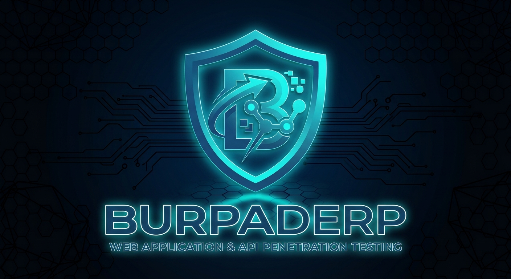
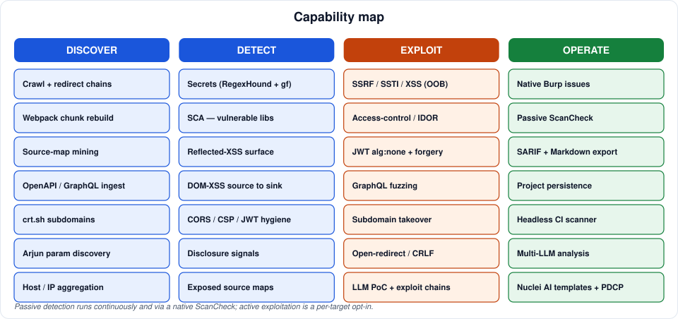
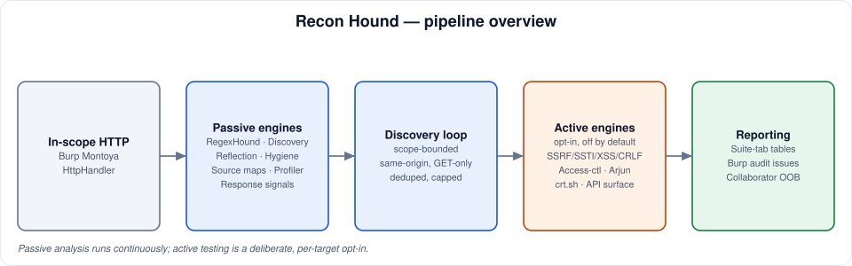
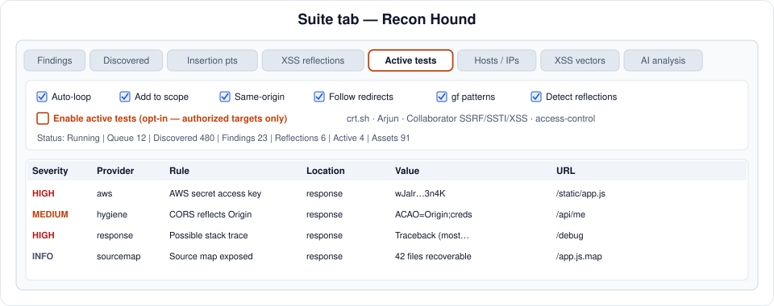
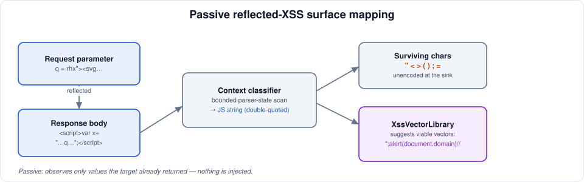
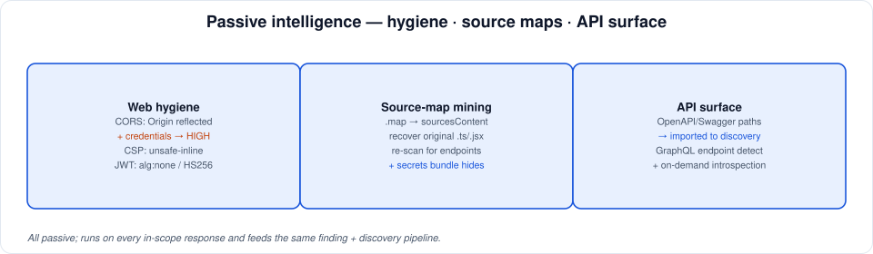
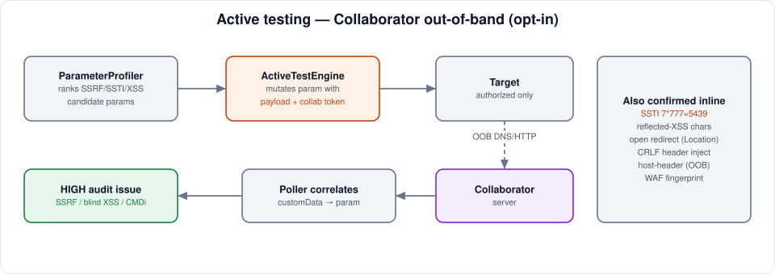
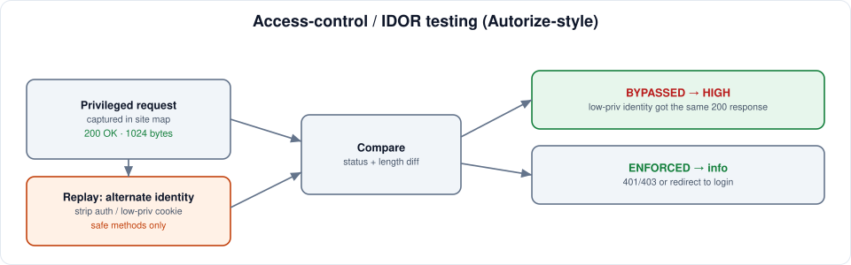
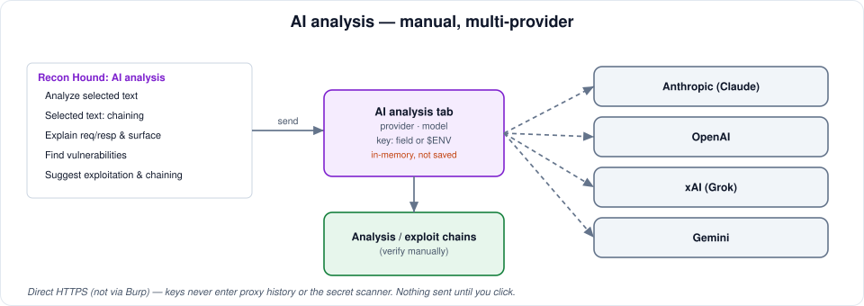
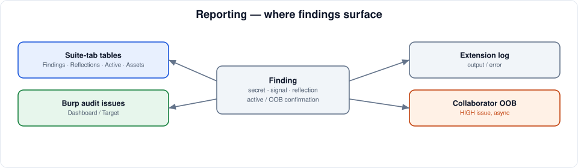

<div align="center">



### The recon-to-exploit toolkit for Burp Suite — passive intel, active testing, and a multi-provider AI agent team you can watch work, all filing **native Burp issues**.

[](https://github.com/MKlolbullen/burpaderp/actions/workflows/ci.yml)
[](https://github.com/MKlolbullen/burpaderp/actions/workflows/release.yml)
[](https://github.com/MKlolbullen/burpaderp/releases/latest)


[**Install**](#install) · [**Capabilities**](#capability-map) · [**AI agent team**](#five-agent-evidence-team) · [**AI feed**](#ai-feed--watch-the-models-work) · [**Control plane**](docs/RUN_GOVERNANCE.md) · [**CLI / CI mode**](#ci-native-scanning-no-burp-required) · [**How it works**](#what-it-does)

</div>

---

## Capability map

Recon Hound spans the full engagement — from mapping attack surface, through detecting weaknesses, to
confirming and chaining them into impact — and everything it finds is filed as a **native Burp audit
issue** (Dashboard / Target), not just a plugin tab. Every LLM call it makes is visible in one place,
and nothing that touches the target happens without a human first.



|  | |
| --- | --- |
| 🔎 **Discover** | Crawl + redirect chains, **webpack-chunk reconstruction**, source-map mining, OpenAPI/GraphQL ingest, crt.sh subdomains, Arjun param discovery, host/IP inventory |
| 🩻 **Detect** | Secrets (RegexHound + `gf`), **SCA** for vulnerable JS libs, reflected-XSS surface, **DOM-XSS** source→sink, CORS/CSP/JWT hygiene, **clickjacking & security-header** checks, **session-cookie & CSRF** hygiene, **excessive data exposure / mass assignment**, **OAuth/OIDC** & **SAML** flaws, debug-endpoint & **BFLA** candidates, disclosure signals, exposed source maps |
| 💥 **Exploit** | Collaborator-backed **SSRF/SSTI/blind-XSS/CMDi**, native **SQLi** (error/boolean/time-based; external sqlmap execution paused), error-based **NoSQL injection**, canary-confirmed **path traversal / LFI**, in-band & OOB **XXE**, active **CORS** origin-bypass confirmation, **rate-limit** & **file-upload** probes, access-control/**IDOR**, **JWT** `alg:none` + weak-secret **forgery**, **GraphQL fuzzing**, **subdomain takeover**, open-redirect/CRLF, opt-in **encoded corpus fuzzing** |
| 🤖 **Agents** | A configurable multi-provider **AI agent team** over the finding inventory — recon → PoC drafter → adversarial verifier → leader — behind a **fail-closed human-approval gate**: it reasons, it never touches the target on its own |
| 🧠 **AI** | Five providers run together — **LLM JS bug-hunt** (PoC), cross-finding **exploit-chaining**, cross-provider **false-positive triage** (majority vote), **Nuclei** AI templates (cloud scan creation paused) |
| 👁️ **Observe** | A single **AI feed** streams every LLM touchpoint — triage, JS review, chaining, Nuclei authoring, agent rounds, and every gate decision — newest-first, with an estimated-usage meter, in-memory and never persisted |
| 📤 **Operate** | Native Burp issues + a passive **ScanCheck**, **SARIF + Markdown** export, per-project **persistence**, a typed Go **`reconctl` sidecar import**, and a **headless CI scanner** (`java -jar`) |

## Install

1. Grab the latest stable `burp-recon-hound-*.jar` from **[Releases](https://github.com/MKlolbullen/burpaderp/releases/latest)**. Stable releases are cut from explicit `vMAJOR.MINOR.PATCH` tags; commits to `main` are built and retained as short-lived CI artifacts.
2. Burp Suite → **Extensions → Installed → Add → Java** → select the jar.

Or build it yourself:

```bash
./gradlew clean build      # -> build/libs/burp-recon-hound-<version>.jar
```

The build accepts any installed JDK 21 or newer and always emits Java 21-compatible bytecode.

> Successor to the original Recon Loop tooling, which was stuck on the legacy Extender API under
> **Jython (Python 2)** — EOL, awkward threading, no Montoya. This is a native Java 21 extension with no
> Python runtime, running on Burp's own JVM with full access to the modern HTTP handler, site map,
> scope, scanner, and UI APIs.

## What it does





- Watches in-scope HTTP requests and responses through a Montoya `HttpHandler`.
- Scans request + response content with the Java `RegexHound` port (secrets, tokens, keys, PEM
  material, cloud credentials, provider-specific patterns, JWTs, and more, with entropy gating and
  placeholder suppression).
- Optionally loads normal `gf` JSON packs from `$GF_PATTERNS_DIR` or `~/.gf/*.json` and applies their
  regex patterns.
- Extracts URLs, API endpoints, imports, `fetch()`/Axios calls, source maps, links, forms, and
  interesting file names.
- Recognizes a broad resource set including `.js`, `.ts`, `.webchunk`, `.map`, `.conf`, `.config`,
  `.cfg`, `.env`, `.bak`, `.backup`, `.old`, `.sql`, databases, certificates/keys, archives,
  OpenAPI/GraphQL artifacts, and more.
- Adds discovered resources/directories to Burp scope when enabled.
- Queues deterministic GET requests for discovered file-like resources and endpoints, re-using the
  origin's captured auth headers.
- Follows redirect chains explicitly and scans every hop.
- Profiles Burp-parsed parameters and ranks likely injection/sink classes such as SQLi, XSS, SSTI,
  path traversal/LFI, command injection/RCE, SSRF, open redirect, and IDOR/BOLA.
- Detects response signals such as stack traces, debug disclosures, source-map references, directory
  listings, and internal-hostname hints.
- Aggregates every unique **host and IP** observed (discovered URLs, crt.sh results, and validated
  IPv4/IPv6 literals in traffic) into a dedicated **Hosts / IPs** asset inventory tab, with
  **Export…** (writes `hosts.txt` / `ips.txt` / `assets.txt` to a chosen folder) and **Add all to
  scope** (adds every collected host/IP to Burp's target scope over http and https).
- Indexes external payload `.txt` corpora without blindly auto-firing them.
- Imports contract-validated `reconctl` JSONL through a bounded, scope-rechecking handoff — no tool is
  launched and no request is sent merely by importing results. See [run governance](docs/RUN_GOVERNANCE.md).

### Passive XSS surface mapping



Recon Hound maps reflected cross-site-scripting surface passively, using techniques distilled from
the PortSwigger XSS cheat sheet:

- **Reflection-context detection** — for every in-scope response whose request carried parameters,
  the extension looks for parameter values echoed verbatim into the body and classifies the
  reflection *context*: HTML element text, single/double-quoted or unquoted attribute, URL attribute
  (`href`/`src`/`action`…), inline `<script>` string or code block, template literal, `<style>`
  block, HTML comment, or RCDATA (`<title>`/`<textarea>`).
- **Surviving-character analysis** — it reports which XSS-relevant metacharacters
  (`< > " ' ` ( ) { } ; = /`) reached the response unencoded at the reflection point, which is what
  decides whether a given class of vector is viable.
- **Context-aware vector suggestions** — `XssVectorLibrary` holds a curated, categorised set of
  cheat-sheet vectors (tag-injection, attribute breakout, `javascript:`/`data:` protocol tricks,
  JavaScript-string breakout, WAF-bypass global-object concatenation, comment-syntax and hex-escape
  obfuscation, UTF-7 / overlong-UTF-8 / HTML-entity encoding bypasses). For each observed reflection
  it surfaces only the vectors whose required characters actually survived.

The results appear in two dedicated tabs — **XSS reflections** (live, per observed sink) and
**XSS vector library** (the full catalogue as a copy-paste reference). High/medium-confidence
reflections are also raised as tentative Burp audit issues.

### Passive web-hygiene, disclosure, and API surface



More passive analysis runs on every in-scope response — all of it observing only what the target
already returned, never injecting anything:

- **Web hygiene** (`WebHygieneEngine`) — flags **CORS** misconfiguration (Origin reflection or
  `null` origin, especially with `Allow-Credentials: true`), weak **CSP** directives
  (`unsafe-inline`/`unsafe-eval`, source wildcards, missing `object-src`/`base-uri`),
  **clickjacking / security-header** gaps (an HTML page with neither `X-Frame-Options` nor a CSP
  `frame-ancestors` directive, plus missing `Strict-Transport-Security` on HTTPS,
  `X-Content-Type-Options: nosniff`, `Referrer-Policy`, and `Permissions-Policy`), **JWT** defects
  (`alg:none`, brute-forceable HMAC, `kid` injection surface), **session-cookie** attribute hygiene
  (missing `HttpOnly`/`Secure`/`SameSite` on session-like cookies), and a **CSRF-protection**
  heuristic (state-changing requests carrying a session cookie with no anti-CSRF token/header).
- **Excessive data exposure & mass assignment** (`DataExposureEngine`) — walks JSON bodies for
  sensitive response fields that shouldn't be exposed, and for privileged request fields that suggest
  a mass-assignment surface.
- **OAuth/OIDC** (`OAuthEngine`) and **SAML** (`SamlEngine`) — passive flow-weakness heuristics:
  implicit/hybrid flows, missing `state`/PKCE, tokens or client secrets in the URL; and, for SAML,
  unsigned messages, weak signature algorithms, multiple-assertion (XSW) signals, and unsafe NameID
  formats, decoding both POST- and Redirect-binding messages.
- **Debug/ops endpoints & BFLA candidates** (`InterestingResourceCatalog`) — flags reachable debug
  and administration tooling, and privileged-looking paths worth an access-control check.
- **Source-map reconstruction** (`SourceMapMiner`) — recovers original source from `.map` files via
  `sourcesContent` and re-scans the recovered code for endpoints and secrets the minified bundle hid.
- **API-surface ingestion** (`ApiSurfaceEngine`) — parses **OpenAPI/Swagger** specs, imports every
  documented path into discovery, flags operations that explicitly **opt out of the spec's default
  authentication**, and detects **GraphQL** endpoints. Introspection is run on demand and its schema
  is scanned for sensitive-sounding fields/mutations.

Confirming a passive lead still means firing a context-appropriate probe against an authorised target.

### Active testing (opt-in, off by default)





An opt-in **Active testing** panel adds discovery and confirmation that require sending crafted
traffic. It is **disabled by default**, scope-checked per request, throttled, and governed by
hierarchical run quotas. High-impact behaviours are separately fail-closed: Collaborator/OAST,
time-delay payloads, upload mutations, authentication/lockout replays, and non-safe HTTP methods each
require their own operator opt-in. Persistent/destructive corpus entries remain blocked. Enable only
the permissions your rules of engagement actually authorize. Changing a permission or disabling active
tests cancels current native runs and invalidates queued jobs. Blind-XSS beacons additionally require
persistent-payload permission and remain blocked until a separate authorization path exists.

Use the **Preview…** actions for native probes, corpus fuzzing, JWT, access-control, takeover, crawl
seeds/queue, parameters and GraphQL before enabling traffic. Previews send nothing and spend no live
quota; captured values and uploaded filenames stay hidden. Response-dependent branches are marked,
and unknown callback/redirect values remain non-executable runtime templates. Dynamic counts describe
an ordered scenario; the configured global run cap remains the hard dispatch ceiling. Detail stops
at 500 candidates with an explicit prefix notice; probe/category filters can inspect later groups.
All native sends require a plan bound to exact Montoya message bytes and service destination.
See [run governance](docs/RUN_GOVERNANCE.md) for coverage, estimate semantics and remaining release gates.

Every parameter-level probe below injects through a shared **insertion-point model** (`InsertionPoint`)
rather than query/body parameters alone — so SQLi, NoSQLi, SSTI, path traversal, reflected/blind XSS,
command injection, open-redirect and CRLF are all exercised across the **whole request surface**:

- every non-cookie **parameter** (URL, body, JSON, XML, multipart);
- **JSON body values** — the body is parsed and each primitive leaf (by RFC-6901 pointer, e.g.
  `/user/role`) becomes an injection point; the payload is set into the parsed tree and the body is
  re-serialised, so nested API fields are reachable, not just top-level form params;
- **URL path segments** — each segment (e.g. the `123` in `/api/users/123`) is a point; payloads are
  percent-encoded so they can't malform the request line;
- a curated allow-list of **fuzzable request headers** (`X-Forwarded-For`/`-Host`, `Referer`,
  `User-Agent`, client-IP and URL/method-override headers, …), probed **whether or not the captured
  request already carried them**, since the classic bug is an endpoint that trusts an absent header
  once it is supplied.

Cookies and transport/auth headers (`Host`, `Authorization`, …) are never mutated, so a probe can't
malform the request or drop the session.

- **crt.sh subdomain enumeration** — passive OSINT against the certificate-transparency log
  (`crt.sh`, never the target). Discovered hosts feed the normal discovery/scope pipeline.
- **Arjun-style parameter discovery** — probes a built-in wordlist (extendable via
  `~/.recon-hound/params.txt`) of common parameter names against an in-scope URL and reports names
  whose canary value is reflected or that materially change the response.
- **Collaborator-backed OOB probes** — for each in-scope parameterised request: **SSRF**, **blind
  XSS**, **OS command injection**, and **host-header injection** carry a correlation tag, and a
  background poller raises a HIGH audit issue when an out-of-band DNS/HTTP interaction confirms the
  callback.
- **SQL injection** (`ActiveTestEngine`) — native **error-based** (DB error signature diffed against a
  baseline), **boolean-based blind** (true-vs-false response divergence), and **time-based blind**
  (MySQL `SLEEP`, PostgreSQL `pg_sleep`, MSSQL `WAITFOR DELAY`) detection, using a small clean payload
  set. External **sqlmap** execution, including binary checks, is paused until its target
  requests can share the outbound policy; native SQLi probes remain available.
- **SSTI** — template-arithmetic polyglots (`{{7*777}}`, `${7*777}`, `#{7*777}`, `<%=7*777%>`, …)
  confirmed only when the distinctive product `5439` is evaluated into the response.
- **NoSQL injection** — error-based, Mongo-style: injects values that break a query or its `$where`
  JavaScript (mismatched quotes, `$where` boolean-OR, an operator object where a scalar is expected)
  and flags HIGH only when a NoSQL driver/parser error signature (`MongoError`, `BSON`, `E11000`,
  `Cast to ObjectId failed`, `$where`, …) appears that was **absent from the baseline** — never a
  response-length heuristic that would false-positive on ordinary dynamic content.
- **Path traversal / LFI** — reads a well-known OS file through the parameter across depth, separator,
  and encoding variants (`../`, `..%2f`, `%2e%2e%2f`, double-encoded, `....//` doubling, Windows `..\`
  and `..%5c`, absolute paths). Confirmed HIGH only when a target-file canary (a `/etc/passwd` root
  line pinned to UID:GID `0:0`, or `win.ini` section markers) appears in the payload response but was
  **absent from the baseline** — so a page that legitimately contains such text is never mis-flagged.
- **XXE** (`XxeEngine`) — only for requests that already carry an XML body. Replaces the body with a
  minimal document declaring an external entity: an **in-band file-read** variant, confirmed HIGH by
  the same `/etc/passwd`/`win.ini` baseline-differenced canaries; and, when a Collaborator is
  configured, an **out-of-band** external-entity payload whose callback the poller correlates
  asynchronously.
- **Reflected-XSS confirmation** — a metacharacter canary reveals which of `< > " '` survive
  unencoded at the sink.
- **Active CORS confirmation** — replays requests with crafted attacker `Origin` headers (arbitrary
  origin, `null`, prefix/suffix bypass, scheme downgrade) and confirms a bug only when the server
  reflects the crafted origin back, HIGH when paired with `Allow-Credentials: true`.
- **Rate-limit weakness** — a small burst of identical requests at login/OTP/reset-shaped endpoints,
  flagged when no `429`/`503`, `Retry-After`, or lockout wording appears.
- **File-upload risk** (`FileUploadEngine`) — flags executable/script extensions and content-type
  mismatches in multipart uploads, and (actively) replays an upload with extension-bypass filename
  variants to see whether the server accepts and stores them.
- **Open redirect** and **CRLF/header injection** — confirmed from the `Location` header and injected
  response headers respectively; plus **WAF fingerprinting** from blocked responses.
- **Access-control / IDOR testing** (`AccessControlEngine`, Autorize-style) — replays privileged
  in-scope requests under an **alternate identity** (supplied session headers, or unauthenticated) and
  compares responses. Only **safe methods** (GET/HEAD/OPTIONS) are replayed by default.
- **JWT attacks** (`JwtAttackEngine`) — replays JWT-bearing GET/HEAD/OPTIONS requests with an
  **`alg:none`** forgery and, when the offline crack recovers the HMAC secret, a token **re-signed
  with the cracked secret and a tampered claim**. Acceptance is a HIGH end-to-end auth bypass.
- **Subdomain-takeover check** (`SubdomainTakeoverEngine`) — fetches enumerated hosts and matches
  known "unclaimed resource" fingerprints (GitHub Pages, S3, Heroku, Fastly, Shopify, …).
- **GraphQL fuzzing** (`GraphQlFuzzEngine`) — field-suggestion leakage, alias amplification, and query
  batching, each filed as a native issue.
- **Encoded corpus fuzzing** (`CorpusFuzzEngine`) — the one path that fires the bundled
  `payloads/*.txt` corpus, and only on an explicit click: it picks categories per parameter, tries
  each payload in one or more **encodings** (raw / URL / HTML-entity / Base64 and chained combinations
  via `PayloadEncoder`), **skips destructive entries** (shells, account/registry/firewall changes,
  webshell writes), and **rewrites hardcoded callback hosts** to this instance's own Collaborator.

Results appear in the **Active tests** tab and, when reproduced or stronger, as Burp audit issues.
Out-of-band findings arrive asynchronously as the Collaborator poller correlates interactions.

**Runnable PoC on the issue.** When an in-band class is confirmed at a query parameter (SQLi, NoSQLi,
SSTI, path traversal, open-redirect, CRLF, reflected XSS), the filed Burp issue carries a
**deterministically generated, runnable Nuclei v3 template** (`NucleiTemplateBuilder`) that re-proves
it — the exact payload placed at the parameter plus the in-band matcher that confirmed it. Unlike the
LLM template feature it involves no model call; it is a portable, CI-runnable artifact you can drop
straight into a `nuclei -t` run against an authorised target. (Header/path/JSON insertion points and
out-of-band classes are planned extensions.)

## The AI layer

Five LLM providers are supported and **run together** when more than one is enabled: **Anthropic
(Claude)**, **OpenAI**, **xAI (Grok)**, **Google Gemini**, and **Venice.ai**, each called over raw
HTTPS (no vendor SDK is bundled). Two principles hold across everything below:

- **Keys never persist and never enter Burp.** API keys come from an in-memory UI field or the
  provider's environment variable (`ANTHROPIC_API_KEY`, `OPENAI_API_KEY`, `XAI_API_KEY`,
  `GEMINI_API_KEY`, `VENICE_API_KEY`). They are never written to the Burp project, and every LLM
  request goes **direct** (not through Burp), so keys never enter the proxy history or trip Recon
  Hound's own secret scanner.
- **Nothing auto-fires.** Every AI action is on-demand, and nothing that puts packets on the target's
  wire happens without an explicit human decision.

### Five-agent evidence team

The **Agent team → Five-agent evidence jobs** workspace runs five dependency-ordered jobs over the
same selected, redacted requests/responses and source files. Stage evidence in **AI analysis**, then
click **Plan agent jobs…** to inspect recipients, procedures, local tools and call limits before running.

| Job / agent | Default provider | Deliverable |
| --- | --- | --- |
| Surface analyst | Gemini | Captured attack surface, sources/sinks, trust boundaries and gaps |
| Vulnerability / PoC analyst | OpenAI | Source-grounded vulnerability candidates and manual PoCs |
| Payload / boundary specialist | Venice | Inert payload variations, parsing/encoding boundaries and prerequisites |
| Skeptical reviewer | xAI / Grok | Every candidate challenged for missing evidence and benign explanations |
| Lead reporter | Anthropic / Claude | Prioritized assessment retaining uncertainty and reviewer disagreement |

Providers are configurable; the reviewer uses a different provider from the two drafting roles.
Versioned review skills cover XSS, CSRF, SSRF, secrets, access control, injection and logic flaws.
Actual local tools index/read/search/compare selected text, decode selected excerpts and check exact
evidence quotes. These tools have no target transport, shell or arbitrary filesystem access.

Each agent has an enforced output-token limit and 0–2 local-tool requests. Default completed runs
use 5–10 provider calls; the hard maximum is 15. Failed jobs skip their dependents, cancellation stops
later calls, and changes to evidence or provider credentials invalidate the plan. Findings stay
**CANDIDATE**; the report preserves source IDs/hashes, manual PoCs, assumptions and both review verdicts.
See [five-agent setup, tools, budgets and failure behavior](docs/FIVE_AGENT_JOBS.md).

The earlier **Run agent team (findings)** action is available under **Prompt tools (raw input)** and
streams into **Agent team → Finding inventory (raw input)**. Its leader synthesis/escalation view
continues to operate on the in-scope finding inventory.

### AI feed — watch the models work

A single **AI feed** tab is the one place that shows *everything the AI is doing*, as a newest-first
stream. Every LLM touchpoint records an event: false-positive **triage** (per provider), **JS review**
(per file), cross-finding **chain analysis**, **Nuclei-template** authoring, each **agent round**,
each bounded **agent job call**, and
— made first-class — the leader's **gate decision** and every **human-approval escalation** it raises.

- Each event carries its kind, provider, model, outcome (`ok` / `error` / `held for human`), estimated
  input/output tokens, and a one-line detail. Filter the stream by **kind** or **provider**.
- A session **usage meter** rolls up event counts and estimated tokens by kind and by provider —
  explicitly an estimate from text length, not billed cost.
- The feed is **in-memory only and never persisted**: prompts and responses can carry target data,
  payloads, and secrets, so it follows the same stance as the keys — nothing touches disk or the proxy
  history. It is a capped, session-lived ring, cleared on demand or on restart.

This gives an engagement a defensible audit trail — the AI proposed *X*, the gate *held* it — without
scattering that record across half a dozen tabs.

### AI analysis (optional, manual)



The **AI analysis** tab sends content you choose (recovered JavaScript, source maps, responses, or a
finding) to the enabled providers for review.

- **Evidence review workspace.** Stage captured HTTP pairs, paste text, or import UTF-8 JavaScript,
  source maps, API specs and other text files. Preview the redacted outbound messages and recipients,
  then explicitly send the same snapshot to one or more providers. Candidate findings include exact
  source excerpts, source hashes, model confidence, assumptions, suggested manual PoCs and remediation.
  Suggested PoCs are never executed and these candidates are not automatically filed as Burp issues.
  See [setup, limits and verification](docs/AI_EVIDENCE_REVIEW.md), including the empty key/model
  variables in [`.env.example`](.env.example). The existing tools are under **Prompt tools (raw input)**
  and retain their existing raw-input behavior.
- **On-demand, nothing auto-fires.** Nothing is sent until you click a button.
- **Automated JS bug-hunt → native issues.** **Analyze in-scope JS** collects in-scope JavaScript
  (deduplicated, skipping files already reviewed) up to a per-run *file budget*, asks the LLM for
  **strict JSON**, and files every finding as a native Burp issue with a **proof-of-concept** and,
  where the model sees it, an **exploit chain**. With several providers enabled, files are
  round-robined across them concurrently for throughput.
- **Cross-finding chaining.** **Chain findings → exploit chains** sends the whole ranked finding
  inventory to the LLM and files each ranked chain as its own native Burp issue with a
  bug-bounty-ready writeup, ordered reproducible steps, and the end impact.
- **False-positive triage.** Triage reviews not-yet-triaged Findings-table rows; with more than one
  provider enabled each verdict is a **majority vote** across providers, written into the table's
  *AI Triage* column in place (the immutable native issue is never retouched).
- **AI Nuclei templates.** A **Nuclei templates (AI)** tab turns a natural-language description into a
  ready-to-run **Nuclei v3 YAML** template using whichever provider is selected — mirroring
  ProjectDiscovery's cloud `POST /v1/template/ai` with no PDCP account.
- **ProjectDiscovery cloud scan.** Starting **cloud Nuclei scans** is paused until downstream target
  requests can be governed. AI template generation and typed JSONL result import remain available.
  `PdcpClient` retains read-only status/result API support; scan creation cannot send an API request.
- **Right-click integration.** Any request/response in Proxy history, the site map, or Repeater has a
  **Recon Hound: AI analysis** submenu to stage selected exchanges for attack-surface review,
  vulnerability review or manual PoC/chain suggestions, plus highlighted-text variants.
  Right-click actions stage locally; review the preview and click **Analyze preview** to send.

Whatever you run here also shows up in the [AI feed](#ai-feed--watch-the-models-work).

> ⚠️ **Privacy:** this sends target-derived data to third-party LLMs. Some bug-bounty programs
> prohibit sharing target data with third parties — only use it on data you are authorised to share.

## Reporting



Native probe results follow an explicit evidence lifecycle: **signal → candidate → reproduced → confirmed →
exploitable** (or rejected). Signals and candidates stay visible in the Active tests table for analyst
follow-up but are not promoted to native Burp issues. Reproduced-or-stronger findings are reportable;
confirmed/exploitable evidence receives stronger issue confidence. Reflected metacharacters and one
timing anomaly are candidates, absence of a rate-limit signal is only a signal, while evaluated SSTI,
CRLF response-header injection and file-read canaries are confirmed detector evidence. A correlated
Collaborator callback confirms the interaction; browser execution and exploit impact need separate proof.
Native helper reports retain their explicit interpretation, including tentative takeover candidates.

[Timing verification](docs/TIMING_VERIFICATION.md) measures admitted transport calls separately from
client preparation/pacing. Corpus delay probes use up to three alternating control/payload pairs;
median/MAD and matched delays are required for REPRODUCED. Partial/inconsistent anomalies remain
CANDIDATE. Missing responses, failed sends and HTTP errors do not become timing samples. Schema-1
project evidence migrates to schema 2 while preserving historical state and marking unknown timings.

Findings surface in several places:

- the Recon Hound **suite tab** tables — **Findings**, **Discovered resources**, **Insertion points**,
  **XSS reflections**, **Active tests**, **Hosts / IPs**, **XSS vector library**, plus the AI views
  (**AI analysis**, **Agent team**, **AI feed**, **Nuclei templates (AI)**);
- Burp's **Dashboard / Target issue list** as native audit issues — reportable findings are filed
  through a single deduplicated reporter; active signals/candidates deliberately remain in the plugin
  until stronger evidence exists. This covers secrets, disclosure signals, reflected-parameter/XSS candidates,
  web-hygiene (CORS/CSP/JWT/cookie/CSRF), data-exposure/mass-assignment, OAuth/OIDC & SAML flaws,
  debug/BFLA candidates, exposed source maps and OpenAPI/GraphQL surface, gf-pattern hits,
  broken-access-control/IDOR, reproduced/confirmed active findings (SQLi, SSTI, CRLF, CORS,
  path traversal/XXE, verified file upload, and Collaborator OOB), vulnerable JS dependencies (SCA),
  JWT defects incl. offline
  weak-secret cracks, heuristic DOM-XSS, and LLM-identified JavaScript bugs (with PoC and chain).
  Informational results are filed at `INFORMATION` so nothing is dropped;
- Burp's **native scan pipeline** — Recon Hound registers a **passive scan check**, so its detectors
  also run when Burp audits traffic; the crawl and scan-check paths share one deduplicated reporter, so
  a finding is never filed twice;
- the **AI feed** for the model side of the engagement, and the extension **output/error log**.

The **Findings** tab can **export** to **SARIF 2.1.0** (code-scanning / CI ingestion) or **Markdown**
(a bug-bounty-ready writeup grouped by severity). Plugin state — the issue-dedupe keys, the host/IP
asset inventory, and the Findings/Hosts rows — is **persisted to the Burp project**
(`api.persistence()`), so reopening the project restores results and avoids re-filing. (The AI feed is
deliberately *not* persisted — see above.)

The **Active tests** table now persists bounded [versioned finding evidence](docs/ACTIVE_EVIDENCE.md):
typed verification state, detector/run provenance, original and actual gateway request/response
observations, and correlated OOB data. **View evidence…** displays read-only JSON/Base64 and explicit
truncation flags. Restore never sends or replays. Raw bytes may include credentials; protect the Burp
project as sensitive evidence. This is finding storage, not a complete run/approval audit log.

The separate [Burp runtime verification kit](docs/BURP_RUNTIME_KIT.md) builds a manual harness JAR and
provides a receiving HTTP/TLS fixture with offline byte comparison. It supports testing actual Burp
routing; CI self-tests do not attest the physical peer or complete the v1.0 release gate.

## CI-native scanning (no Burp required)

The same jar analyzes saved response bodies with its Burp-free passive engines (secret detection,
SCA, heuristic DOM-XSS and source-map recognition):

```bash
java -jar burp-recon-hound.jar --body-file artifacts/app.js --content-type application/javascript \
  --fail-on high -o recon-hound.sarif https://target.example/app.js
```

The single HTTP(S) URL is artifact metadata and is never resolved or fetched. Live URL fetching is
paused until it can use the shared outbound policy. A live invocation, including `--file targets.txt`,
exits **3** before creating or replacing a report, even with `--fail-on none`. `--body-file` accepts one
regular local file and exactly one metadata URL; `--content-type` defaults to `text/html`. Offline
analysis does not establish public accessibility of a detected source map.

Offline mode creates report directories and writes **SARIF 2.1.0**. Exit codes are 0 clean, 1 findings
meeting `--fail-on` (`high` / `medium` / `low` / `info` / `none`), 2 bad input, and 3 blocked live fetching.
The **Recon Scan** workflow (`.github/workflows/recon-scan.yml`) accepts a saved body path already in
the checkout and its metadata URL; it performs no target download.

## Run governance & the `reconctl` sidecar

The **Recon chain** tab runs a bounded provider/DNS/archive workflow using subfinder, assetfinder,
chaos-client, pinned passive Amass, dnsx, waybackurls, urlfinder and Waybackpy. Its optional native
HTTP phase probes, fingerprints, crawls and extracts JavaScript endpoints through the shared Burp
gateway with one quota ledger. Captured requests/responses and JS can be staged locally for the
existing AI/five-agent review. The original httpx, WhatWeb, Katana, GoSpider, Cariddi and JSFinder
processes remain blocked pending governed egress; offline report adapters are available. See the
[runnable chain, limits and tool-support table](recon/README.md#runnable-recon-chain).

Active behaviour is governed by an explicit control plane: a per-run request policy and hard request
**budget** gate every native Montoya target dispatch. Each active run carries a scope snapshot.
Native sends now resolve/validate DNS answers and bind a numeric Montoya service with original SNI
and message bytes; Burp physical-peer verification remains a release gate. See the
[DNS/API contract and runtime limits](docs/RUN_GOVERNANCE.md#dns-and-numeric-service-binding).
Findings carry an explicit verification state rather than a loose "confirmed" flag. An optional typed Go **`reconctl`** sidecar
blocks unsupported target-HTTP producers even with opt-in flags, while retaining provider/DNS
profiles, explicit opt-in TCP scans and typed input/output contracts; Burp **re-checks scope** when importing its JSONL, and importing never launches a tool or
sends a request. See **[run governance and the sidecar handoff](docs/RUN_GOVERNANCE.md)** and the
[recon contracts](docs/RECON_CONTRACTS.md).

## Safety / scope controls

Passive analysis observes only what the target already returned. Active behaviour is:

- opt-in and **off by default**;
- Burp-scope bounded, same-origin by default, and request/redirect capped;
- gated by the per-run request policy plus **global / per-host / per-endpoint / per-probe quotas**;
- split into explicit risk permissions: non-safe HTTP methods, **OAST/Collaborator**, **time-delay**,
  **upload mutation**, and **authentication/lockout** probes are all off until separately enabled;
- persistent/destructive corpus payloads remain hard-disabled rather than being exposed behind a
  convenient "do something regrettable" checkbox;
- and, for the AI agent team, held behind a **fail-closed human-approval gate** — the team reasons
  but never touches the target on its own, and every gate decision is recorded in the AI feed.

Payload execution and XSS-vector firing are deliberately separate from discovery. The bundled corpora
contain time-based, OOB, and potentially destructive strings and are only fired by the explicit
corpus-fuzz action, which filters destructive entries and redirects callbacks to your own
Collaborator. Only test targets you are authorised to assess.

## Build

Requires Java 21. The checked-in Gradle wrapper pins and verifies the build toolchain:

```bash
./gradlew clean build
```

The build targets:

```text
net.portswigger.burp.extensions:montoya-api:2026.7
```

Load the generated JAR (`build/libs/burp-recon-hound-<version>.jar`) through **Burp Suite →
Extensions → Installed → Add → Java**.

## Payloads

The bundled `payloads/` directory contains the supplied XSS, SQLi, SSTI, LFI, and RCE corpora. At
runtime the extension looks for payloads in:

```text
$RECON_HOUND_PAYLOADS
./payloads
~/.recon-hound/payloads
~/payloads
```

They are indexed but never auto-fired — only the opt-in **corpus fuzz** action sends them, with
destructive entries filtered and callback hosts rewritten to your Collaborator.

## gf patterns

Normal gf-json files are discovered from `$GF_PATTERNS_DIR` or `~/.gf/*.json`. The lightweight loader
supports both a single `"pattern"` and an array of `"patterns"`, plus case-insensitive `flags`
containing `i`.

## Project layout

```text
src/main/java/com/victor/reconloop/
├── ReconLoopExtension.java        # BurpExtension entry point
├── ReconController.java           # HttpHandler + discovery/scan/AI orchestration
├── ReconPanel.java                # Suite tab UI
├── ReconModel.java                # Swing table models
├── ReconContextMenu.java          # right-click "AI analysis" submenu
├── ReconHoundCli.java             # headless CI scanner entry point
├── ReconScanCheck.java            # native Burp passive ScanCheck
├── IssueReporter.java             # single deduplicated audit-issue sink
│
│   # discovery / passive intel
├── DiscoveryEngine.java · InterestingResourceCatalog.java · ParameterProfiler.java
├── ResponseSignalEngine.java · GfPatternLoader.java · RegexHound.java
├── XssReflectionEngine.java · XssVectorLibrary.java · DomXssEngine.java
├── WebHygieneEngine.java · DataExposureEngine.java · OAuthEngine.java · SamlEngine.java
├── SourceMapMiner.java · WebpackMiner.java · ApiSurfaceEngine.java · DependencyVulnEngine.java
│
│   # active testing
├── ActiveTestEngine.java          # SSRF/SSTI/XSS/CMDi/CRLF/SQLi/CORS/rate-limit + Collaborator OOB
├── AccessControlEngine.java · JwtAttackEngine.java · GraphQlFuzzEngine.java
├── SubdomainTakeoverEngine.java · FileUploadEngine.java
├── CorpusFuzzEngine.java · PayloadEncoder.java · PayloadLibrary.java
├── CertificateTransparencyClient.java · ParameterDiscoveryEngine.java · SqlmapClient.java
│
│   # AI + multi-agent + observability
├── LlmProvider.java               # Anthropic / OpenAI / xAI / Gemini / Venice
├── LlmClient.java                 # on-demand LLM analysis over raw HTTPS
├── ReasoningEffort.java           # provider-neutral low→max effort mapping
├── AgentRole.java · AgentTeam.java · AgentOrchestrator.java · ActionGate.java
├── AgentActivity.java             # curated per-run agent-team activity model
├── AiFeed.java                    # global, capped, in-memory LLM activity feed
├── PdcpClient.java                # ProjectDiscovery cloud Nuclei
│
│   # run governance + reporting
├── RequestPolicy.java · RequestBudget.java · ActiveRequestGateway.java
├── ScanRun.java · ScanProfile.java · RunStatus.java · ScopeSnapshot.java · VerificationState.java
├── SidecarEvent.java · SidecarEventImporter.java   # reconctl JSONL import
├── PersistedState.java · ReportExporter.java · Json.java

recon/                             # typed Go `reconctl` sidecar (contracts, router, adapters)
payloads/                          # xss / sqli / ssti / lfi / rce corpora (never auto-fired)
docs/                              # RUN_GOVERNANCE.md, RECON_CONTRACTS.md, SAFETY_ROADMAP.md, img/
```
