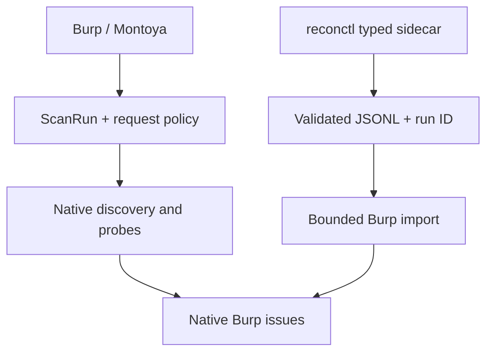

# Run governance and sidecar handoff

Recon Hound is one product with two deliberately different execution planes:



- Burp owns captured authentication, target scope, request mutation, Collaborator, evidence markers,
  issue filing, project persistence, and operator decisions.
- `reconctl` owns external binaries, typed streams, adapters, deduplication, process time/size caps,
  and quarantine.

This avoids reimplementing Burp in Go while avoiding shell-pipe orchestration inside the extension.

## Enforcement now

| Boundary | Enforced behavior |
| --- | --- |
| Go process start | `network_probe` and `active_fuzz` are off by default; `--allow-network` / `--allow-active` are explicit. |
| Go tool input/output | `ToolSpec` plus `ContractSocket` validates kinds, schema, scope, size limits, and quarantines rejected JSONL. |
| Go execution identity | `reconctl run` emits a UUID `run_id` on every accepted output record and in its run summary. |
| Burp safe HTTP paths | Discovery crawl/redirects, parameter discovery, JWT read-only replay, and subdomain-takeover checks run through `ScanRun` + `RequestPolicy` + `ActiveRequestGateway`; only in-scope `GET`/`HEAD`/`OPTIONS` requests can dispatch, and each logical run has one atomic request budget. |
| Go → Burp import | The importer bounds line/record count, parses only canonical record kinds, re-checks current Burp scope, and rejects payload/CIDR records that have no safe Burp-side materialisation. Importing never launches a process, adds scope, queues a crawl, or sends traffic. |
| Evidence lifecycle | `SIGNAL`, `CANDIDATE`, `REPRODUCED`, `CONFIRMED`, `EXPLOITABLE`, and `REJECTED` replace a lossy boolean. Legacy `true` maps conservatively to `REPRODUCED`. |

Native target paths now share the gateway. The invariant and its explicit remaining release gates
are described below; external producers are not covered by the native Montoya guarantee.

## Importing sidecar output

Build the sidecar from the `recon/` module, then give each execution either a Burp `ScanRun` UUID or
let `reconctl` generate one:

```bash
cd recon
go build -o reconctl ./cmd/reconctl

printf '%s\n' '{"kind":"domain","value":"example.com"}' \
  | ./reconctl run --tool subfinder --scope-domain example.com \
      --run-id 123e4567-e89b-42d3-a456-426614174000 \
      > subfinder.jsonl
```

In Burp, choose **Import reconctl JSONL…** in the Active testing section and select the output file.
Imported domains, hosts, resolved addresses, services, URLs, parameterized URLs, and findings feed
the existing asset/discovery/parameter tables and the single `IssueReporter` sink. External findings
are filed with `TENTATIVE` confidence until reproduced in the current Burp session.

Rejected import lines are counted and a representative reason is written to the extension output log.
The Go-side quarantine stream remains the authoritative artifact for malformed tool output.

## Native outbound invariant

Every native target-directed Montoya dispatch passes `ActiveRequestGateway`. The controller alone
constructs `MontoyaTargetTransport`; engines receive a caller-owned run and gateway and cannot
create their own authorization or reset the run budget. The transport uses `RedirectionMode.NEVER`.
A crawler redirect is checked against current scope before the discovery auto-add setting is allowed
to observe it, and every followed hop is admitted and charged separately.

The gateway requires a `RequestPlan`, not metadata alone. It binds method/URL and a SHA-256 digest
of `HttpRequest.toByteArray()` to the service host, effective port and TLS flag. The URL and service
destination must agree. Missing inspection data, substituted requests, changed authentication
headers/body, or a changed transport destination fail closed before quota acquisition. Binding is
checked again after policy callbacks/quota acquisition; a change in that interval may conservatively
spend a token but cannot dispatch. This binds the immutable Montoya message at the dispatch boundary,
not bytes after Burp session handling, other extensions, DNS resolution or connection establishment.

The caller owns one run for an active/corpus pass, including its targets, parameters, baselines and
payload categories. The crawler reuses one run across queued URLs and redirects. Pausing cancels that
run; resuming uses only the unspent crawl cap. Reset explicitly starts new accounting. Host/endpoint/
probe reservations are atomic with the global cap, and an explicit default port does not create a
second endpoint quota.

Disabling active tests, changing a risk grant, resetting, or unloading cancels the affected runs.
Enqueue-time generation tickets prevent old jobs from starting again after disable/re-enable,
including jobs already preparing targets but not yet registered. Cancellation does not wait for a
blocking response: a request already admitted may finish, but the next admission fails. A dispatch
that throws is still charged; a cancellation race may conservatively spend a token without a send.
These are Montoya dispatch counts, not a claim to meter internal Burp TCP retries/retransmissions.

Persistent payload permission has no UI grant. Blind-XSS beacons require it as well as OAST and stay
blocked. An OAST grant alone must not silently authorize a potentially stored browser payload.

### Dry-run preview

The **Preview params…**, **Preview introspection…** and **Preview GraphQL fuzz…** buttons work even
with active sending disabled. They do not enqueue active work, send HTTP, allocate Collaborator
payloads, add scope/site-map entries, or reserve live quota. The preview assumes active sending will
be enabled and reports current policy decisions, missing risk grants, all four budget limits and
admissible request counts. Actual execution still checks scope, permissions, cancellation and quota.

| Action | Shared request construction | Estimate |
| --- | --- | --- |
| Parameter discovery | `ParameterDiscoveryEngine.probes` / `plan`: GET baseline, then chunks of at most 20 new URL parameters with generated canaries | Upper bound; chunks require a baseline response. A denied baseline skips dependent steps. Added names/counts are shown; captured values are hidden. |
| GraphQL introspection | `GraphQlRequestPlanner.introspection`: POST + JSON content type + introspection body | One candidate request, subject to policy and quotas. |
| GraphQL fuzz | `GraphQlRequestPlanner.fuzz`: suggestion, 100-alias and batch bodies | Three candidate requests, subject to policy and quotas. |
| Other native paths | Byte/service binding applies at every gateway call | Full pre-execution mutation preview remains outstanding for active/corpus, JWT, access-control, takeover and crawler paths. Response-dependent branches need explicit conditional plans. |

`RequestPreview.inspect` uses an isolated copy of the existing run ledger and the same admission
routine as dispatch. It does not reserve capacity: concurrent sends or changed settings can change
the subsequent result. At most 500 steps are evaluated; a truncated preview explicitly describes
only that prefix. Original URL paths/query values, headers and body never enter the display report,
including quota-denial messages. No synthetic responses are used to speculate about dynamic probes.

### Verification

`OutboundGatewayInvariantTest` resolves Java API owners and catches method references, aliases,
whitespace changes, batch sends and alternate Montoya request engines. It also prevents engines
from calling the raw gateway sender. The fixed-origin crt.sh client is the sole native HTTP exception;
it uses one-hop options too, and its origin/redirect behavior has an integration regression test.

`OutboundRunIntegrationTest`, `ReconControllerRunLifecycleTest`, `RedirectPolicyIntegrationTest` and
`NativeControllerDispatchIntegrationTest`, `CorpusRiskPermissionIntegrationTest` and
`NativeRiskPermissionIntegrationTest` exercise production paths with an in-memory Montoya transport.
They meter actual transport calls, including shared engine budgets and concurrent dispatches, rather
than asserting only on a local integer. Run them with the existing JDK 21 `./gradlew test` task.

`RequestPlanIntegrationTest` checks byte/transport substitution, missing inspection data and changes
during policy evaluation. `RequestPreviewIntegrationTest` compares the shared builders against actual
transport calls, checks each quota dimension against a populated ledger, tests denied prerequisites,
conditional/truncated estimates, redaction, and controller previews with active sending disabled.

### Remaining release gates

This invariant is scoped to native Montoya target traffic. The standalone JDK CLI, external sqlmap,
HTTP-producing Go profiles and PDCP scan creation are separate producers; native request quotas do
not meter their downstream traffic. Their process flags or validated output records are not proof of
a per-request gateway. They need controlled egress or a fail-closed execution boundary before the
product can claim a unified outbound guarantee.

Issue #44 also still requires dry-run coverage for the remaining native flows, destination validation
tied to the actual DNS/connection path, and versioned structured evidence persistence. Plans here
are in-memory dispatch bindings, not persisted approval artifacts or run audit trails. Do not
interpret passing native tests as closing #44 or approving v1.0.
