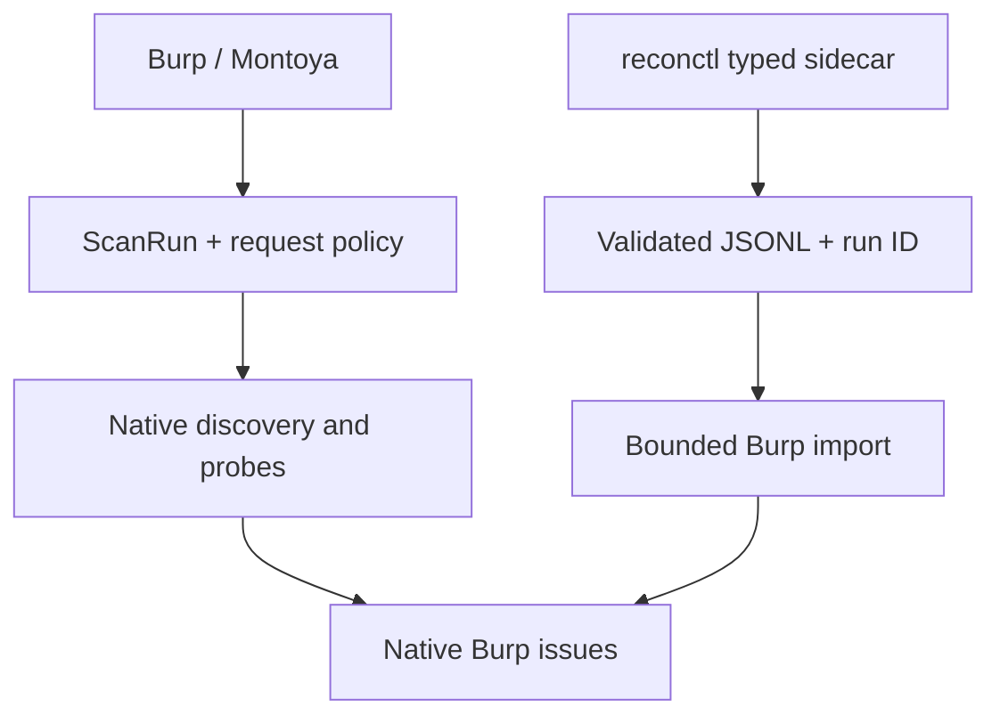

# Run governance and sidecar handoff

Recon Hound is one product with two deliberately different execution planes:



- Burp owns captured authentication, target scope, request mutation, Collaborator, evidence markers,
  issue filing, project persistence, and operator decisions.
- `reconctl` owns external binaries, typed streams, adapters, deduplication, process time/size caps,
  and quarantine.

This avoids reimplementing Burp in Go while avoiding shell-pipe orchestration inside the extension.

## Enforcement now

| Boundary | Enforced behavior |
| --- | --- |
| Go process start | The sole runner resolves the canonical binary/profile and blocks target HTTP egress before command construction, regardless of risk opt-ins. Provider/DNS profiles and opt-in TCP connect scans remain separate capabilities. |
| Go tool input/output | `ToolSpec` plus `ContractSocket` validates kinds, schema, scope, size limits, and quarantines rejected JSONL. |
| Go execution identity | `reconctl run` emits a UUID `run_id` on every accepted output record and in its run summary. |
| Java → provider/DNS sidecar | Only `DomainReconProcess.launch` may call `ProcessBuilder.start`, with fixed `reconctl enumerate` or `workflow` arguments. No shell, pipeline or arbitrary tool arguments are enabled. The Go boundary still rejects all target-HTTP CLI profiles. Java validates the domain, bounds, UUID and versioned event stream; interruption/unload cleans up observed processes. |
| Burp safe HTTP paths | Discovery crawl/redirects, parameter discovery, JWT read-only replay, and subdomain-takeover checks run through `ScanRun` + `RequestPolicy` + `ActiveRequestGateway`; only in-scope `GET`/`HEAD`/`OPTIONS` requests can dispatch, and each logical run has one atomic request budget. |
| Go → Burp import | The importer bounds line/record count, parses only canonical record kinds, re-checks current Burp scope, and rejects payload/CIDR records that have no safe Burp-side materialisation. Importing never launches a process, adds scope, queues a crawl, or sends traffic. |
| Evidence lifecycle | `SIGNAL`, `CANDIDATE`, `REPRODUCED`, `CONFIRMED`, `EXPLOITABLE`, and `REJECTED` replace a lossy boolean. Legacy `true` maps conservatively to `REPRODUCED`. |

Native target paths now share the gateway. The invariant and its explicit remaining release gates
are described below. Unsupported external target-HTTP producers are now fail-closed.

## Importing sidecar output

Build the sidecar from the `recon/` module, then give each execution either a Burp `ScanRun` UUID or
let `reconctl` generate one:

```bash
cd recon
go build -o reconctl ./cmd/reconctl

printf '%s\n' '{"kind":"domain","value":"example.com"}' \
  | ./reconctl run --tool subfinder --scope-domain example.com \
      --run-id 123e4567-e89b-42d3-a456-426614174000 \
      > subfinder.jsonl
```

In Burp, choose **Import reconctl JSONL…** in the Active testing section and select the output file.
Imported domains, hosts, resolved addresses, services, URLs, parameterized URLs, and findings feed
the existing asset/discovery/parameter tables and the single `IssueReporter` sink. External findings
are filed with `TENTATIVE` confidence until reproduced in the current Burp session.

Rejected import lines are counted and a representative reason is written to the extension output log.
The Go-side quarantine stream remains the authoritative artifact for malformed tool output.

## Native outbound invariant

Every native target-directed Montoya dispatch passes `ActiveRequestGateway`. The controller alone
constructs `MontoyaTargetTransport`; engines receive a caller-owned run and gateway and cannot
create their own authorization or reset the run budget. The transport uses `RedirectionMode.NEVER`.
A crawler redirect is checked against current scope before the discovery auto-add setting is allowed
to observe it, and every followed hop is admitted and charged separately.

The gateway requires a `RequestPlan`, not metadata alone. It binds method/URL and a SHA-256 digest
of `HttpRequest.toByteArray()` to the service host, effective port and TLS flag. The URL and service
destination must agree. Missing inspection data, substituted requests, changed authentication
headers/body, or a changed transport destination fail closed before quota acquisition. Binding is
checked again after policy callbacks/quota acquisition; a change in that interval may conservatively
spend a token but cannot dispatch. This binds the immutable Montoya message at the dispatch boundary,
not bytes after Burp session handling, other extensions or connection establishment. The numeric
service binding below handles the separate DNS-to-Montoya-destination step.

Binding adds `UPLOAD` whenever any Content-Type header declares `multipart/*`, regardless of the
probe label or HTTP method. A generic probe replaying an unchanged captured multipart file therefore
needs the upload grant too. Missing upload permission denies before DNS preparation and quota
acquisition. Native previews derive the same requirement, including runtime templates. Unavailable
header inspection fails closed; a caller-supplied permission set cannot remove the inferred grant.

The caller owns one run for an active/corpus pass, including its targets, parameters, baselines and
payload categories. The crawler reuses one run across queued URLs and redirects. Pausing cancels that
run; resuming uses only the unspent crawl cap. Reset explicitly starts new accounting. Host/endpoint/
probe reservations are atomic with the global cap, and an explicit default port does not create a
second endpoint quota.

Disabling active tests, changing a risk grant, resetting, or unloading cancels the affected runs.
Enqueue-time generation tickets prevent old jobs from starting again after disable/re-enable,
including jobs already preparing targets but not yet registered. Cancellation does not wait for a
blocking response: a request already admitted may finish, but the next admission fails. A dispatch
that throws is still charged; a cancellation race may conservatively spend a token without a send.
These are Montoya dispatch counts, not a claim to meter internal Burp TCP retries/retransmissions.

The **Allow persistent / stored browser payloads** checkbox grants `PERSISTENT_PAYLOAD` separately
from OAST; both default off. Blind-XSS beacons require both grants, including for GET requests.
OAST alone cannot authorize a potentially stored browser payload, and the persistent grant alone
cannot authorize a callback. Non-safe methods still need the mutating replay grant. Changing either
grant cancels current active runs and invalidates queued jobs; re-enabling cannot revive them.
Already dispatched browser payloads may execute later, even after permission is revoked.
Destructive corpus entries remain filtered regardless of these grants. Automated XSS corpus execution uses [reviewed browser recipes](CORPUS_BROWSER_POLICY.md): local markers require the persistent grant, controlled beacons require both grants, and unreviewed browser entries remain quarantined even with all grants.

### DNS and numeric-service binding

`DestinationAddress.inspect` is a pure parser/classifier used by policy and transport. It rejects
ambiguous integer/abbreviated/octal/hex IPv4 forms, scoped or malformed IPv6, protected hostname
aliases (including trailing-dot localhost/metadata names), private/link-local/loopback, multicast,
selected special-use/documentation ranges and the Azure platform virtual IP. IPv4-mapped IPv6 is
classified by its embedded IPv4 and canonicalized to dotted decimal; compatible/translation/6to4
and other non-public IPv6 space is conservatively blocked. No protected-network override is added.
This is a conservative public-target subset, not a dynamically maintained IANA registry.

For a native target send, `ActiveRequestGateway` first checks the bound logical request and policy.
The production `MontoyaTargetTransport` implements `PreparedSender.prepare`: `DestinationGuard`
resolves a hostname once using the system/JDK resolver's complete returned A/AAAA address list.
Every returned address must be numeric and permitted; mixed public/protected sets are denied in
full. An empty/malformed/failed answer, timeout or capacity exhaustion denies before quota acquisition.
Public literals bypass DNS. Scope, method/risk grants, run cancellation and request binding are
checked again after preparation; the four quotas are still reserved atomically immediately before
dispatch. Concurrent DNS preparation cannot create extra HTTP budget tokens.

The default resolver has a five-second caller deadline and at most four daemon workers with no
queue. A timed-out system lookup may finish later if the OS ignores interruption; its result cannot
send target HTTP. DNS queries themselves are not HTTP dispatches and are outside the HTTP ledger.
JDK/OS resolver caching and search rules apply; Burp's custom DNS or hostname-resolution settings are
not used for this lookup. Resolver failure never falls back to hostname-based sending.

The prepared dispatch uses `request.withService(HttpService.httpService(validatedNumericIp, port,
secure))`, `RedirectionMode.NEVER` and the logical DNS name as TLS SNI. No Host/authority/header/body
rewrite is allowed: bytes must equal the source message before quota admission and again immediately
before `api.http().sendRequest`. A failed transformation cannot inherit the original approval.
`PreparedSender.send` cannot send directly; the source guard restricts preparation/dispatch consumers
and forbids using `HttpService.ipAddress()` as a connection check. That API dynamically resolves a
name; it is not a record of an already established connection.

`LogicalRequestResponse` restores the logical service association for findings/caches while retaining
Burp's actual returned request bytes, response, timing, annotations and marker transformations. This
association does not attest a physical peer. [Run history](SCAN_RUNS.md) records API dispatch attempts; it does not attest physical egress.
Every redirect re-enters the same preparation/admission sequence. Dry-run stays entirely offline;
its policy/quota counts do not approve DNS results or guarantee numeric-service binding will succeed.

The API-level guarantee is **the service destination supplied to Montoya is the checked numeric IP**,
with no second hostname lookup performed by this extension. Montoya exposes no pre-send physical-peer
validation hook in the pinned API. Burp's proxies, SOCKS, hostname overrides, connection reuse, session
handling, other extensions and the runtime's TLS behavior remain trusted/unverified at that boundary.
The implementation must not be described as a wire-level destination guarantee. The outstanding
[Burp runtime test matrix](DESTINATION_BINDING_VERIFICATION.md) is part of the release gate, not a
passing in-memory fixture. A strict physical-peer guarantee may require controlled egress outside
Montoya; preflight DNS alone cannot establish it.

Primary contracts: [Montoya HttpService](https://portswigger.github.io/burp-extensions-montoya-api/javadoc/burp/api/montoya/http/HttpService.html),
[RequestOptions](https://portswigger.github.io/burp-extensions-montoya-api/javadoc/burp/api/montoya/http/RequestOptions.html),
[IANA IPv4 special-purpose registry](https://www.iana.org/assignments/iana-ipv4-special-registry/),
[IANA IPv6 special-purpose registry](https://www.iana.org/assignments/iana-ipv6-special-registry/), and
[Azure platform IP](https://learn.microsoft.com/en-us/azure/virtual-network/what-is-ip-address-168-63-129-16).

### Dry-run preview

Every native target-testing/crawl workflow listed below has a **Preview…** action. Previews work with active sending disabled and run
in a background UI worker. They do not enqueue work, register an executing run, send HTTP, allocate
Collaborator payloads, expand scope/site-map inventory, or reserve live quota. The report assumes the
selected workflow will be enabled and shows current risk decisions, all four limits, existing global
usage/remaining capacity, and a bounded candidate scenario. Execution still rechecks every concrete
request through the gateway.

| Action | Request construction / interface | Estimate and conditions |
| --- | --- | --- |
| Parameter discovery | `ParameterDiscoveryEngine.probes` / `plan`: GET baseline and chunks of at most 20 new URL parameters | Upper bound if the baseline returns a response. A denied baseline skips dependent chunks. Added names/counts are shown, captured values hidden. |
| GraphQL introspection / fuzz | `GraphQlRequestPlanner.introspection` / `fuzz` | One introspection candidate or three fuzz candidates (suggestion, 100 aliases, batch), subject to policy/quotas. |
| Active probes | `ActiveTestEngine.plan(base, probeFilter)` | Candidate catalog shares payload constants, `InsertionPoint.apply`, callback/XML/upload builders and permission derivation with execution. Includes baseline/error/boolean/timing branches, NoSQL, traversal, headers, CORS, auth bursts, uploads and XXE. Baseline admission dependencies are explicit; earlier confirmations can skip later candidates. |
| Corpus fuzz | `CorpusFuzzEngine.plan(base, parameter, encodings, maxPerCategory, categoryFilter)` | Shares destructive filtering, raw risk classification, callback rewriting, encoding and parameter mutation with execution. Encodings have stable enum order. Each parameter/category has its own local cap inside the run caps. Timing expands to at most three alternating control/payload pairs. Each control requires two remaining global/local tokens; later pairs depend on earlier admissions and completed responses. Failure/denial skips dependent samples. Every dispatched invocation, including transport errors, consumes the local category cap. |
| JWT | `JwtRequestPlanner.plan`, `baseline`, `noneVariants`, `weakSecret` | Original replay, four alg:none variants and an optional offline weak-secret forgery. Forgeries require baseline admission and a successful response. Tokens/claims/signing keys never enter display text. |
| Access-control replay | `AccessControlEngine.plan` | Same cached-response safe-method selection and identity mutation as execution. Cookie/Authorization are removed and configured headers applied; values stay hidden. |
| Takeover | `TakeoverRequestPlanner.plan` / `step` | Stable host ordering, root HTTPS GET, then HTTP fallback unless HTTPS matched a fingerprint. |
| Crawl | `ReconController.previewCrawl(seedText)` / `crawlStep` | Existing queued URLs precede new seed inputs; comments and duplicates are skipped. Uses the same authenticated GET builder and an existing crawl-ledger snapshot or the remaining resume cap. Future redirect targets remain unknown; preview does not follow them or predict future discovery. |

`NativeRequestRecipe` builds a concrete `NativeRequestStep` lazily. Known requests receive the same
byte/service-bound `RequestPlan` required at dispatch. Callback-dependent recipes use an inert
`.invalid` placeholder and **no executable binding**. Unknown redirect destinations are metadata-only
continuations. These are displayed as `PENDING_BINDING` / `PENDING_DESTINATION` when their known
method/literal-destination/permission checks pass, and are excluded from quota simulation. Exact
scope and quota admission wait for the real request. `RequestPolicy.assessTemplate` is a partial
preview assessment; the architecture test forbids execution code and method references from using
it. The gateway always evaluates the full policy.

`RequestPreview.inspect` uses an isolated copy of the existing run ledger and the same gateway
admission routine. For dynamic flows its count describes an **ordered candidate scenario**, not a
worst-case bound: response branches, early matches and runtime values change which requests run.
The configured global run cap remains the hard dispatch ceiling. Preview does not reserve capacity;
concurrent sends or changed settings can change the result. No synthetic responses or fake timing
measurements are used to drive the active engine.

At most 500 candidates are evaluated. Truncated counts describe only that prefix. Probe/category
filters make later groups inspectable; a filtered count covers that selection alone and does not
change what the Run action executes. Original URL paths/query values, header/body values, uploaded
filenames and detector evidence stay out of the display report, including quota-denial reasons.
Generated insertion-point names and variant/encoding identifiers are shown with bounded, control-safe
text. Active/corpus candidate catalogs must be updated with new probe variants; integration tests
compare production transport calls and per-probe cardinality against the catalog across request
surfaces.

### Verification

`OutboundGatewayInvariantTest` resolves Java API owners and catches method references, aliases,
whitespace changes, batch sends and alternate Montoya request engines. It also prevents engines
from calling the raw gateway sender, prepared dispatch, or DNS lookup APIs outside their owners. The fixed-origin crt.sh client is the sole native HTTP exception;
it uses one-hop options too, and its origin/redirect behavior has an integration regression test.

`OutboundRunIntegrationTest`, `ReconControllerRunLifecycleTest`, `RedirectPolicyIntegrationTest` and
`NativeControllerDispatchIntegrationTest`, `CorpusRiskPermissionIntegrationTest` and
`NativeRiskPermissionIntegrationTest` exercise production paths with an in-memory Montoya transport.
They meter actual transport calls, including shared engine budgets and concurrent dispatches, rather
than asserting only on a local integer. Run them with the existing JDK 21 `./gradlew test` task.

`RequestPlanIntegrationTest` checks byte/transport substitution, missing inspection data and changes
during policy evaluation. `RequestPreviewIntegrationTest` compares the shared builders against actual
transport calls, checks each quota dimension against a populated ledger, tests denied prerequisites,
conditional/truncated estimates, redaction, and controller previews with active sending disabled.
`NativeProbePreviewIntegrationTest` compares every dispatch and per-probe count in a no-early-hit pass
against the active catalog across parameters, JSON, path, headers, XML and multipart. It also checks
corpus caps/encoding/timing pairs, pending template isolation, denied dependencies, bounded lazy
construction, and a branch counterexample where a greedy count is smaller than another valid branch.
`NativeControllerPreviewIntegrationTest` covers read-only preview entry points, JWT/identity/takeover
parity, crawler continuation/queue ordering, existing accounting and secret-free display.

`DestinationAddressTest` checks protected/ambiguous forms and randomized byte-based IPv6 round trips.
`DestinationBindingIntegrationTest` meters actual in-memory Montoya calls for numeric service/SNI and
byte preservation, rebinds between sends, mixed/invalid/failed DNS, deadline/capacity/interruption,
post-DNS cancellation/scope revocation, redirect hops, empty global quota and preparation failures.
It also checks logical evidence association and an offline preview. Existing concurrent run-budget,
lifecycle, native surface and preview suites now inject explicit public DNS fixtures; no live resolver
is used by those tests. The previews compare logical message bindings separately from physical API
service pinning. `RegexHound` IPv6 validation also uses the pure parser, so offline CLI analysis cannot
trigger a name lookup through passive literal validation.

## External target-HTTP execution boundary

Native run grants authorize only native gateway dispatches. An external process or remote scan cannot
turn an initial scoped URL, a process timeout/rate flag, a run ID or validated output into per-request
permission. Until these producers have controlled egress, their active execution is disabled at the
lowest production entry point, with no opt-in bypass.

| Producer / prior direct sink | Enforced boundary and retained behavior | Regression evidence |
| --- | --- | --- |
| `ReconHoundCli.main` → JDK `HttpClient.send`, automatic `NORMAL` redirects | No HTTP client or target sender remains. `run(args, err)` returns 3 for live inputs before writing a report, including `--fail-on none`. `--body-file` analyzes one saved response with an HTTP(S) metadata URL, without DNS or HTTP. | `ReconHoundCliTest`: local listener stays untouched, existing report preserved, offline SARIF/severity exits and invalid input. CLI JAR smoke runs without Montoya on the classpath. |
| `SqlmapClient.run` / `isAvailable` → `ProcessBuilder.start` | Neither scan execution nor `--version` can start a process. `run` returns `started=false` with a block reason. Pure argument/output helpers remain. `ReconController.runSqlmap` blocks before queuing; UI execution controls are removed. | `ExternalTargetEgressIntegrationTest`: executable marker remains absent with unsafe arguments; controller calls stay blocked with native grants enabled or disabled. Java architecture test rejects starts/references outside the single fixed passive-sidecar launcher; pipelines and `Runtime.exec` remain forbidden everywhere. |
| `PdcpClient.createScan` → `POST /v1/scans` → remote Nuclei target requests | Returns a block reason without HTTP. Controller blocks before resolving credentials or scheduling work. Read-only existing status/results stay fixed to `https://api.projectdiscovery.io` with GET and `Redirect.NEVER`. There is no create/poll loop or launch button. | `PdcpClientEgressTest`: no creation transport calls, GET-only fixed-origin reads and redirecting client rejection. Controller integration checks completion/error callback and no native sends. |
| `recon.RunProfile` → `RunExternal` → `exec.CommandContext` for `httpx`, `katana`, `nuclei` | `CheckProfileEgress` rejects their canonical `target_http_unsupported` profiles regardless of every risk flag. The private `runExternal` repeats the check at process start and resolves the binary internally; it accepts no binary override. Unknown/unprofiled tools cannot execute. Existing output adapters, `socket`, `render`, `adapt`, `plan` and import stay offline. | `egress_test.go`: all flags granted, zero executions and no executable marker via either entry point. `process_invariant_test.go` resolves import aliases and function references; only the runner may construct processes. |

Go profiles retained for execution are explicitly `assetfinder`/`subfinder`/`chaos`/version-guarded `amass`/`waybackurls`/`urlfinder`/`waybackpy`/`gau` (provider queries), `puredns`/`dnsx`
(DNS), and `naabu` (TCP connect, still requires `--allow-network` and network scope). These do not share
native HTTP quotas. The contract trusts installed binaries and their pinned invocation semantics; it
is not an operating-system network sandbox against replaced binaries, configuration or tool changes.
`doctor` exposes execution-block reasons and `plan` exposes each profile's egress class. New tools
need an explicit profile/egress review; the regression allowlist prevents silent new capabilities.

The **Recon chain** form now runs eight fixed provider/DNS/archive profiles and a local URL union.
Amass is guarded by exact v3.23.3 output before passive enumeration; Waybackpy only uses CDX reads.
All original HTTP CLI profiles, including WhatWeb/GoSpider/Cariddi/JSFinder, remain blocked with no
opt-in bypass; offline report adapters are separate. The optional native GET probe/fingerprint/crawl/
JS phase uses the existing `ActiveRequestGateway`, numeric service binding and current Burp scope.
One `ScanRun` ledger covers initial roots, archives, HTTPS transport fallbacks, redirects and extracted
links. The preview discloses global/host/endpoint/probe quotas, URL/depth/rate/deadline bounds and
anonymous request behavior. Native registry invalidation and thread interruption prevent a fresh
send after reset/cancellation; an in-flight call may finish until its 15-second response timeout.

Provider artifacts are reparsed and correlated before any native candidate can dispatch. Versioned
exchange evidence is retained with linked workflow/native run IDs and explicit byte omissions;
observations are `SIGNAL`, never automatic vulnerability confirmation. Local staging of captured
requests/responses/JS does not call a provider or run a PoC. Native transport/fingerprinting is a
basic role implementation, not scanner equivalence or physical socket/TLS attestation. The existing
physical Burp release gate remains. `chain-result.json` records the overall sidecar/native result;
per-phase files remain separate. A dedicated asset worker avoids importer starvation behind the
crawler's long-running loop. See [the runnable workflow](../recon/README.md#runnable-recon-chain).

This slice deliberately reduces functionality instead of asserting that a process-level permission
can govern downstream sends. Restoring CLI fetching needs a policy-bound one-hop JDK transport,
shared run accounting/cancellation, destination validation and preview. Restoring external active
processes needs an enforceable proxy/sandbox/adapter that cannot bypass the gate, including redirects,
auxiliary protocols and child processes. Remote cloud scans need a verifiable downstream enforcement
contract; cancelling or budgeting the API POST alone is insufficient. These disabled features can wait
beyond v1.0; re-enabling them without equivalent enforcement cannot.

### Remaining release gates

Bounded [versioned finding evidence](ACTIVE_EVIDENCE.md) now persists typed native/corpus/helper and
OOB observations. Issue #44 still requires verification/control of the actual Burp connection path
beyond the checked numeric API destination. Native plans remain in-memory dispatch bindings, not
persisted approval artifacts. [Native run history](SCAN_RUNS.md) adds bounded audit trails and exact quota totals; it does not establish physical egress. TCP/DNS/provider process traffic is explicitly outside the
native HTTP dispatch ledger. Full-product wire-level isolation is not established by these gates.
Do not interpret passing native/external-boundary tests as closing #44 or approving v1.0.

Timing verification now uses separate monotonic transport durations, completed responses and bounded
repetitions; [the timing contract](TIMING_VERIFICATION.md) describes states, exclusions, preview
conditions and schema-1 migration. This does not change the outstanding Burp connection-path gate.
