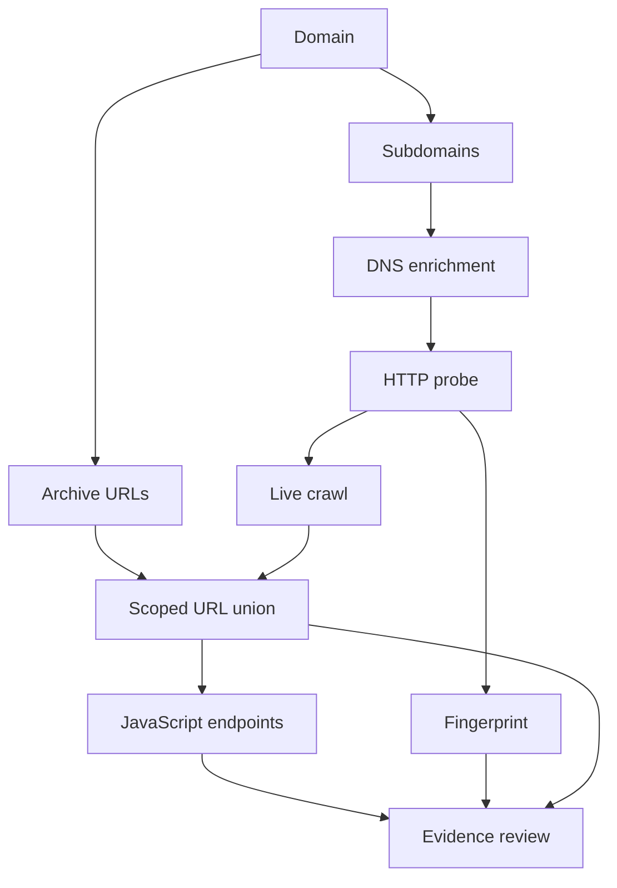

# Recon Hound typed recon sidecar

This directory is the Go data-plane foundation for the external-tool pipeline. The Burp extension stays Java/Montoya: Burp is the control plane, authenticated traffic source, evidence viewer, issue sink, and operator UI. Go is used where it is strongest here: concurrent CLI orchestration, typed streaming contracts, process lifetime management, normalization, and high-volume de-duplication.

The important design rule is **tools do not pipe arbitrary strings directly into other tools**. Every boundary is:

```text
tool output -> adapter -> typed Record -> scope/schema contract -> dedupe -> next tool input contract
                                  \
                                   -> quarantine JSONL on failure
```

## Contracts

`Record.Kind` is one of:

- `domain`
- `hostname`
- `resolved_host` (`hostname + A/AAAA/CNAME`)
- `ip` / `cidr`
- `service` (`ip/host + port + protocol`)
- `http_target` (`normalized URL + status + host/port`)
- `url`
- `parameterized_url`
- `payload`
- `finding`

`ToolRegistry` declares exactly which kinds each external tool may consume and produce. `ContractSocket` enforces that declaration in both directions, canonicalizes the data, applies scope policy, bounds record/line sizes, and writes failures to a quarantine stream with the tool, direction, source, raw record, and reason.

## The network-scope rule

**A domain being in scope does not automatically make every IP it resolves to safe for network scanning.** Shared hosting, anycast, reverse proxies, and CDNs make that assumption wrong.

The `resolved_host -> ip` transform therefore marks addresses `derived=true`. `naabu` and `masscan` accept only `ip|cidr`; the scope contract then requires either:

1. an explicitly authorised IP/CIDR, or
2. the deliberate `allow-derived-ips` override plus provenance linking the address to an in-scope hostname.

HTTP probing preferentially keeps the hostname instead of substituting the IP, preserving Host/SNI semantics.

## Payload router

`router.go` formalizes the existing `payloads/` semantics. In particular:

- `rce.txt` is `role=parameter_hint`; it cannot be fired as a payload corpus.
- `rce_payloads.txt` is a payload family and requires destructive-payload filtering plus controlled OAST callback rewriting.
- payloads may only route to a `parameterized_url` target — an explicit injection-point contract.

This complements the existing Java `CorpusFuzzEngine`; it does not remove its hard request budgets, destructive filters, or Collaborator rewrite logic.

## Tool adapters implemented

`adapters.go` has real normalization paths for:

- hostname-line / simple JSON outputs: subfinder, amass, assetfinder, chaos, findomain, puredns, alterx, dnsgen, mksub
- `dnsx` JSONL -> `resolved_host`
- `naabu` JSONL -> `service`
- `httpx` JSONL -> `http_target`
- katana / gau / cariddi URL output -> `url`
- `gf` parameterized URLs -> one `parameterized_url` per query parameter
- Arjun JSON document -> `parameterized_url[]`
- Nuclei JSONL -> bounded `finding`
- `trufflehog` `--json` JSONL -> bounded `finding` (verified secrets escalate to `high`)
- `gitleaks` JSON report (array document) -> bounded `finding[]` via `ParseGitleaksReport`

`masscan` is intentionally not guessed as line-oriented JSON. Dalfox/Corsy/CRLFuzz output is also quarantined until a machine-stable adapter is declared, as is the human-readable or file-only output of XSStrike, XSRFProbe, SSRFire, scan4secrets and postleaks (see below). **Unsupported output fails closed.**

## Web vulnerability + secret-exposure tools

The catalog models several additional weakness-finding tools so a multi-tool run
can cover XSS, CSRF, SSRF and secret exposure in the same typed stream — without
piping raw strings between processes.

| Tool | Consumes | Produces | Risk | Output status |
| --- | --- | --- | --- | --- |
| `xsstrike` | `parameterized_url` | `finding` | `active_fuzz` | fail-closed (human stdout only) |
| `xsrfprobe` | `http_target`/`url` | `finding` | `active_fuzz` | fail-closed (writes a report tree) |
| `ssrfire` | `domain` | `finding` | `active_fuzz` | fail-closed (needs an OAST server; writes `output/<domain>/`) |
| `scan4secrets` | `http_target`/`url` | `finding` | `active_fuzz` | fail-closed (JSON/JSONL written to a report file) |
| `postleaks` | `domain` | `finding` | `passive_osint` | fail-closed (JSON written to an output folder) |
| `gitleaks` | source (not modeled) | `finding` | `passive_osint` | **adapter implemented** (`ParseGitleaksReport`) |
| `trufflehog` | source (not modeled) | `finding` | `passive_osint` | **adapter implemented** (`--json` JSONL) |

Like `dalfox`, the XSS specialist `xsstrike` only accepts an explicit
`parameterized_url` injection point, never a bare `url`, and active web
scanners remain blocked until both a pinned adapter and governed target egress exist.
`--allow-active` alone never enables them. Registering a tool with a
fail-closed adapter is deliberate: it pins the typed contract (what may cross the
boundary) now, while the version-specific output parser is added later. No
executable `CommandProfile` is declared for these tools, so `reconctl run` will
not launch them until a pinned invocation + adapter pair exists; their contracts
are still enforced by `reconctl plan`/`edge` and by the `adapt` boundary.

### postleaks -> gitleaks / trufflehog

`postleaks` searches Postman's public library for a keyword/domain and writes the
matching request bodies to an output folder. That folder is exactly the kind of
filesystem source `gitleaks` and `trufflehog` are built to scan, so the intended
flow is:

```text
postleaks -k example.com --output pml/   # dump candidate Postman requests
gitleaks   dir pml/ --report-format json   -> ParseGitleaksReport -> finding[]
trufflehog filesystem pml/ --json          -> trufflehog adapter  -> finding[]
```

Because the *source* consumed by these secret scanners (a git repo, a filesystem
tree, a Postman export) is not yet a pipeline `Kind`, execution is not wired, but
their report output already normalizes into the same bounded `finding` records
every other stage emits — so a Java/Montoya bridge or `reconctl adapt` can import
them directly.

## `reconctl`

Build/test:

```bash
cd recon
go test ./...
go vet ./...
go build ./cmd/reconctl
```

Inspect the declared graph and installed binaries:

```bash
./reconctl plan
./reconctl doctor
./reconctl edge --from httpx --to katana
```

Validate a normalized stream before feeding a tool:

```bash
cat hosts.jsonl | ./reconctl socket \
  --tool dnsx \
  --direction input \
  --scope-domain example.com \
  --rejects run/rejects.jsonl
```

Validate normalized tool output:

```bash
cat dnsx.records.jsonl | ./reconctl socket \
  --tool dnsx \
  --direction output \
  --scope-domain example.com \
  --rejects run/rejects.jsonl
```

`socket` deliberately does not execute the tool. Execution, output parsing, and contract validation are separate layers so one bad parser or process cannot bypass scope policy by accident.

## Domain form and chained recon plan

The plugin's **Recon chain** tab accepts a bare ASCII/punycode domain, a trusted `reconctl`
executable and an output directory. **Preview recon chain** launches nothing: it shows dependencies,
tool support and the exact fixed argument vector. The manifest can be exported as JSON. The same
catalog, `chain_catalog.json`, is embedded into Go and packaged in the extension JAR.

| Stage | Tools | Current support |
| --- | --- | --- |
| Subdomains | assetfinder, subfinder, chaos-client (`chaos`) | Runnable together from the form or `enumerate` |
| Additional subdomains | Amass | Plan only; version/passive semantics and output profile must be pinned |
| DNS enrichment | dnsx | Existing separate typed CLI stage; not launched by the form |
| HTTP metadata | httpx, WhatWeb | Target execution blocked (#44); WhatWeb also needs its report adapter |
| Archive URLs | Waybackpy, waybackurls, urlfinder | Plan only; provider profiles/adapters need implementation |
| Live crawl | Katana, GoSpider, Cariddi | Target execution blocked (#44); missing adapters still need implementation |
| JavaScript endpoints | JSFinder | Live retrieval blocked (#44); pinned output adapter still needed |
| Evidence review | Existing AI analysis / five-agent jobs | Separate manual selection, redaction and provider preview |

Archive collection branches directly from the seed domain. It does not depend on a live HTTP
response. Merge archive and crawl candidates as a scoped union; retain query strings and provenance,
drop fragments, and never equate an archived URL with a currently live service. DNS CNAMEs/IPs do not
expand scope. The `resolved_host -> hostname` projection before probing must be explicit; the
existing `dnsx -> httpx` edge is intentionally not a direct typed pipe. The full DAG is a **planning
manifest**, not an implemented all-tool scheduler. Planned artifacts are labelled in the catalog.



```bash
# Offline planning only: no tool installation or network required.
./reconctl chain --domain example.com > recon-chain.json

# Provider queries: requires installed assetfinder, subfinder and chaos on PATH.
# Set PDCP_API_KEY through your environment/config for Chaos; never put it in command arguments.
./reconctl enumerate --domain example.com --output-dir ./recon-runs \
  --max-hosts 5000 --tool-timeout-seconds 300
```

**Run passive enumeration** starts the existing Go runner with a fixed argument vector, without a
shell or Python dependency. Go invokes assetfinder (`--subs-only`), subfinder
(`-silent -json -all -recursive -disable-update-check`) and chaos
(`-silent -disable-update-check -d`) sequentially through `RunProfile` and both typed sockets.
Subfinder's `-recursive` restricts sources to those supporting recursive queries; it is not an
active recursive brute-force stage. Provider binaries/configuration are trusted and not sandboxed.
Unrelated LLM key environment variables are removed from the Java-launched sidecar; provider
configuration is retained. Raw stderr is never displayed in Burp or copied to the summary.

Each run exclusively creates `<output-dir>/<canonical-domain>/<UUID>/`, never overwriting another
run. Files are private to the current OS user where supported:

- `target.json`: canonical target, run UUID and limits.
- `subs.txt`: newly accepted hosts in collection order, once each (built-in `anew` equivalent).
- `sorted_subs.txt`: sorted unique hosts, atomically finalised, including after handled cancellation.
- `hosts.jsonl`: ordinary typed records with run UUID and first-source provenance, suitable for the existing importer.
- `summary.json`: per-tool accepted/rejected counts, failure/timeout/truncation states and host-limit status.
- `chain-plan.json`: complete staged planning manifest with execution support states.
- `httpx-plan.json`: **BLOCKED** metadata argument plan; no `httpx.jsonl` is collected.

The httpx plan includes `-ip -td -cname -tls-grab -server -title` plus status, length, location and
timing fields. `-title` is the actual page-title option; there is no `-name` option. No automatic
redirect following, TLS/CSP target expansion or execution bypass is enabled. WhatWeb's lowest
aggression level still sends target HTTP and follows redirects. Waybackpy's future provider profile
must use CDX/availability reads and exclude SavePageNow, which can trigger a target fetch.

Defaults: 5,000 unique hosts and 300 seconds per tool; configurable ranges 1–25,000 hosts and
5–1,200 seconds. Each enumerator captures at most 8 MiB stdout and 32 KiB stderr. Host rows arrive
after each tool completes; all updates carry the same UUID/domain. Missing tools, failed providers,
truncated output or the host cap produce explicit partial/failed states; other tools continue.
No results is distinct from all tools failing. `PARTIAL` returns exit 0 with its explicit terminal
state; `FAILED`/`CANCELLED` return nonzero. A broken event consumer stops further launches.

**Cancel job** interrupts the worker, signals the sidecar and terminates its observed descendants,
then forcefully cleans up remaining observed processes. CLI SIGINT/SIGTERM is handled via context
cancellation. Force termination, process escape/reparenting and crashes cannot guarantee complete
final files; this is process lifecycle management, not an OS egress sandbox. Partial `subs.txt` and
`hosts.jsonl` may remain. The UI rejects malformed, oversized, miscorrelated or incomplete event
streams and contradictory terminal/exit statuses. Stale events from cancelled runs are ignored.

**Import hosts into Burp** is a separate action that rechecks the current Burp scope through the
existing bounded JSONL importer. Enumeration neither adds domains to Burp scope nor starts a crawl,
AI provider call or PoC. Completed partial runs can be imported when they contain hosts.

Build `reconctl` for the machine running Burp (`go build -o reconctl ./cmd/reconctl`, or
`reconctl.exe` on Windows). CI also includes a Linux amd64 binary beside the JAR; after extracting,
restore its executable bit with `chmod +x reconctl-linux-amd64` if needed. Install provider tools
separately from their official releases. No automatic package installation or update runs.

Tool references: [Subfinder](https://github.com/projectdiscovery/subfinder),
[assetfinder](https://github.com/tomnomnom/assetfinder),
[Chaos](https://github.com/projectdiscovery/chaos-client),
[httpx](https://github.com/projectdiscovery/httpx),
[WhatWeb](https://github.com/urbanadventurer/WhatWeb),
[Waybackpy](https://github.com/akamhy/waybackpy).

## Next integration boundary

The Java/Montoya JSONL importer feeds validated asset/finding events into the existing models and
`IssueReporter` without starting tools. The separate domain form launches only the fixed passive
enumeration subcommand; extending it to the planned downstream stages must preserve the egress
restrictions below and attach the explicit scan run. Burp message mutation and evidence markers
remain in the extension.

## Target HTTP execution is paused (#44)

`httpx`, `katana` and `nuclei` retain pinned command descriptions and output adapters, but cannot
execute through `run`, even with `--allow-active` or all `RunPolicy` fields enabled. Both `RunProfile`
and the private process-start boundary reject canonical unsupported egress before any binary starts.
Unknown/unprofiled tools are blocked too. `doctor` reports the execution block; `plan` includes egress
classes. Existing `adapt`, `socket`, `render` and Burp JSONL import stay available without execution.

Provider-only `assetfinder`/`subfinder`/`chaos`/`gau`, DNS `puredns`/`dnsx`, and explicitly opted-in TCP `naabu` profiles remain
available. Their installed binaries and pinned invocation semantics are trusted; this is not a network
sandbox and their traffic is not charged to a native HTTP run. Restoring target-HTTP profiles requires
an enforceable per-request egress adapter covering scope, redirects, quotas, permissions and
cancellation, rather than additional process flags. See [run governance](../docs/RUN_GOVERNANCE.md).
