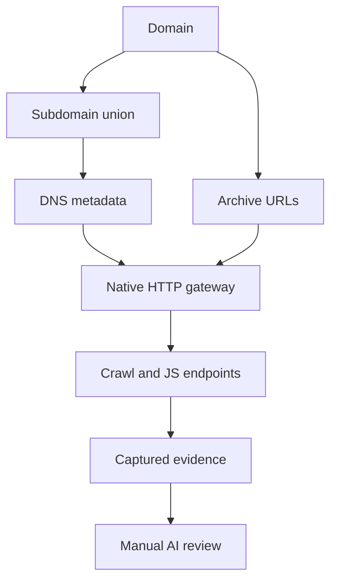

# Recon Hound typed recon sidecar

This directory is the Go data-plane foundation for the external-tool pipeline. The Burp extension stays Java/Montoya: Burp is the control plane, authenticated traffic source, evidence viewer, issue sink, and operator UI. Go is used where it is strongest here: concurrent CLI orchestration, typed streaming contracts, process lifetime management, normalization, and high-volume de-duplication.

The important design rule is **tools do not pipe arbitrary strings directly into other tools**. Every boundary is:

```text
tool output -> adapter -> typed Record -> scope/schema contract -> dedupe -> next tool input contract
                                  \
                                   -> quarantine JSONL on failure
```

## Contracts

`Record.Kind` is one of:

- `domain`
- `hostname`
- `resolved_host` (`hostname + A/AAAA/CNAME`)
- `ip` / `cidr`
- `service` (`ip/host + port + protocol`)
- `http_target` (`normalized URL + status + host/port`)
- `url`
- `parameterized_url`
- `payload`
- `finding`

`ToolRegistry` declares exactly which kinds each external tool may consume and produce. `ContractSocket` enforces that declaration in both directions, canonicalizes the data, applies scope policy, bounds record/line sizes, and writes failures to a quarantine stream with the tool, direction, source, raw record, and reason.

## The network-scope rule

**A domain being in scope does not automatically make every IP it resolves to safe for network scanning.** Shared hosting, anycast, reverse proxies, and CDNs make that assumption wrong.

The `resolved_host -> ip` transform therefore marks addresses `derived=true`. `naabu` and `masscan` accept only `ip|cidr`; the scope contract then requires either:

1. an explicitly authorised IP/CIDR, or
2. the deliberate `allow-derived-ips` override plus provenance linking the address to an in-scope hostname.

HTTP probing preferentially keeps the hostname instead of substituting the IP, preserving Host/SNI semantics.

## Payload router

`router.go` formalizes the existing `payloads/` semantics. In particular:

- `rce.txt` is `role=parameter_hint`; it cannot be fired as a payload corpus.
- `rce_payloads.txt` is a payload family and requires destructive-payload filtering plus controlled OAST callback rewriting.
- payloads may only route to a `parameterized_url` target — an explicit injection-point contract.

This complements the existing Java `CorpusFuzzEngine`; it does not remove its hard request budgets, destructive filters, or Collaborator rewrite logic.

## Tool adapters implemented

`adapters.go` has real normalization paths for:

- hostname-line / simple JSON outputs: subfinder, amass, assetfinder, chaos, findomain, puredns, alterx, dnsgen, mksub
- `dnsx` JSONL -> `resolved_host`
- `naabu` JSONL -> `service`
- `httpx` JSONL -> `http_target`
- katana / gau / cariddi URL output -> `url`
- `gf` parameterized URLs -> one `parameterized_url` per query parameter
- Arjun JSON document -> `parameterized_url[]`
- Nuclei JSONL -> bounded `finding`
- `trufflehog` `--json` JSONL -> bounded `finding` (verified secrets escalate to `high`)
- `gitleaks` JSON report (array document) -> bounded `finding[]` via `ParseGitleaksReport`

`masscan` is intentionally not guessed as line-oriented JSON. Dalfox/Corsy/CRLFuzz output is also quarantined until a machine-stable adapter is declared, as is the human-readable or file-only output of XSStrike, XSRFProbe, SSRFire, scan4secrets and postleaks (see below). **Unsupported output fails closed.**

## Web vulnerability + secret-exposure tools

The catalog models several additional weakness-finding tools so a multi-tool run
can cover XSS, CSRF, SSRF and secret exposure in the same typed stream — without
piping raw strings between processes.

| Tool | Consumes | Produces | Risk | Output status |
| --- | --- | --- | --- | --- |
| `xsstrike` | `parameterized_url` | `finding` | `active_fuzz` | fail-closed (human stdout only) |
| `xsrfprobe` | `http_target`/`url` | `finding` | `active_fuzz` | fail-closed (writes a report tree) |
| `ssrfire` | `domain` | `finding` | `active_fuzz` | fail-closed (needs an OAST server; writes `output/<domain>/`) |
| `scan4secrets` | `http_target`/`url` | `finding` | `active_fuzz` | fail-closed (JSON/JSONL written to a report file) |
| `postleaks` | `domain` | `finding` | `passive_osint` | fail-closed (JSON written to an output folder) |
| `gitleaks` | source (not modeled) | `finding` | `passive_osint` | **adapter implemented** (`ParseGitleaksReport`) |
| `trufflehog` | source (not modeled) | `finding` | `passive_osint` | **adapter implemented** (`--json` JSONL) |

Like `dalfox`, the XSS specialist `xsstrike` only accepts an explicit
`parameterized_url` injection point, never a bare `url`, and active web
scanners remain blocked until both a pinned adapter and governed target egress exist.
`--allow-active` alone never enables them. Registering a tool with a
fail-closed adapter is deliberate: it pins the typed contract (what may cross the
boundary) now, while the version-specific output parser is added later. No
executable `CommandProfile` is declared for these tools, so `reconctl run` will
not launch them until a pinned invocation + adapter pair exists; their contracts
are still enforced by `reconctl plan`/`edge` and by the `adapt` boundary.

### postleaks -> gitleaks / trufflehog

`postleaks` searches Postman's public library for a keyword/domain and writes the
matching request bodies to an output folder. That folder is exactly the kind of
filesystem source `gitleaks` and `trufflehog` are built to scan, so the intended
flow is:

```text
postleaks -k example.com --output pml/   # dump candidate Postman requests
gitleaks   dir pml/ --report-format json   -> ParseGitleaksReport -> finding[]
trufflehog filesystem pml/ --json          -> trufflehog adapter  -> finding[]
```

Because the *source* consumed by these secret scanners (a git repo, a filesystem
tree, a Postman export) is not yet a pipeline `Kind`, execution is not wired, but
their report output already normalizes into the same bounded `finding` records
every other stage emits — so a Java/Montoya bridge or `reconctl adapt` can import
them directly.

## `reconctl`

Build/test:

```bash
cd recon
go test ./...
go vet ./...
go build ./cmd/reconctl
```

Inspect the declared graph and installed binaries:

```bash
./reconctl plan
./reconctl doctor
./reconctl edge --from httpx --to katana
```

Validate a normalized stream before feeding a tool:

```bash
cat hosts.jsonl | ./reconctl socket \
  --tool dnsx \
  --direction input \
  --scope-domain example.com \
  --rejects run/rejects.jsonl
```

Validate normalized tool output:

```bash
cat dnsx.records.jsonl | ./reconctl socket \
  --tool dnsx \
  --direction output \
  --scope-domain example.com \
  --rejects run/rejects.jsonl
```

`socket` deliberately does not execute the tool. Execution, output parsing, and contract validation are separate layers so one bad parser or process cannot bypass scope policy by accident.

## Runnable recon chain



The plugin's **Recon chain** tab previews a frozen job and exports its dependency manifest. The
workflow runs these branches without shell pipelines:

1. `assetfinder` → `subfinder` → `chaos` → version-pinned passive `amass`, merging scoped hosts.
2. `dnsx` enriches the merged hosts with A/AAAA/CNAME metadata.
3. `waybackurls` → `urlfinder` → Waybackpy CDX reads collect archive candidates independently of live HTTP.
4. Local union preserves URL escapes, exact query ordering and duplicate-source provenance.
5. If **Run governed HTTP / crawl / JS phase** is selected, the plugin probes candidate roots and
   archive URLs, follows admitted redirects, fingerprints responses, crawls links and extracts static
   JavaScript endpoints through the existing native outbound gateway.
6. **Stage captured evidence for AI review** stages bounded captured requests/responses and JS
   locally. The existing AI workspace then previews redaction and provider sharing before any API call.

The JSON catalog is a planning template, never interpreted as arbitrary process arguments. Root,
archive and crawl-follow-up HTTP candidates are scheduled round-robin. Each discovered URL receives
its own plan, current Burp scope check, protected-destination check and atomic quota acquisition.
A domain being in scope does not authorise its CNAMEs/IPs as separate targets. Scope is never
expanded automatically, and import remains a separate current-scope-checked action.

| Tool / stage | Implemented path |
| --- | --- |
| assetfinder, subfinder, chaos-client (`chaos`) | Pinned provider profiles; sequential scoped host union |
| Amass | Exact **v3.23.3** required by a bounded `-version` check before `enum -passive -nocolor -json - -dir . -d DOMAIN`; other versions fail without enumeration |
| dnsx | Pinned DNS JSONL profile after host union; hostname remains the target identity |
| waybackurls | Provider-only stdin domain profile; plain original URLs |
| urlfinder | Passive all-source JSONL, update checks disabled, provider rate limit 5/sec |
| Waybackpy | CDX `--match-type domain --collapse urlkey --cdx-print original --limit 25000`; **never SavePageNow** |
| httpx | Existing offline JSONL adapter; CLI execution blocked; native GET metadata phase available |
| WhatWeb | Offline JSON report-array adapter via `adapt-report`; CLI execution blocked; native fingerprint signals available |
| Katana / Cariddi | Existing offline URL adapters; CLI execution blocked; native bounded crawl available |
| GoSpider | Offline JSON `output` URL adapter; CLI execution blocked; native bounded crawl available |
| JSFinder | Offline `-ou` URL-export adapter; CLI live retrieval blocked; native static JS extraction available |

The native phase is a basic implementation of those HTTP/crawl/extraction roles. It does **not**
claim WhatWeb/Wappalyzer fingerprint coverage, headless browser execution, TLS certificate grabbing,
or compatibility with every scanner option. Running the original HTTP CLI processes remains blocked
by #44: output validation, process flags and a proxy flag cannot enforce their downstream requests.
Installing a binary never unlocks that boundary. The physical Burp connection-path verification
release gate is unchanged; fixture tests establish API behavior, not wire-level attestation.

### Run

Build `reconctl` for the machine running Burp:

```bash
cd recon
go build -o reconctl ./cmd/reconctl
# Use reconctl.exe on Windows.

# Offline template: launches nothing.
./reconctl chain --domain example.com > recon-chain.json

# Runnable provider + DNS + archive branch. No target HTTP processes run.
./reconctl workflow --domain example.com --output-dir ./recon-runs \
  --max-hosts 5000 --max-urls 10000 --tool-timeout-seconds 300

# Original three-enumerator mode remains available.
./reconctl enumerate --domain example.com --output-dir ./recon-runs
```

Install tools separately from their official projects and select the trusted sidecar executable in
Burp. The form defaults to the full provider/DNS/archive workflow; uncheck **Include Amass, DNS and
archive collectors** for the original three-tool job. Chaos reads `PDCP_API_KEY`/configuration;
no key is passed in argv. API/configuration for other provider tools remains under their normal
configuration. Unrelated LLM key variables are removed from the Java-launched sidecar environment.
Subfinder's `-recursive` filters to sources supporting recursive queries; it is not DNS brute forcing.
Installed binaries and configuration are trusted; this is not an OS network sandbox. Tool success
means the command completed successfully, not that every upstream provider returned complete data.

Native HTTP is disabled initially. Enable it, choose budgets/depth and preview again before running.
The preview includes conditional runtime candidates, exact quotas and the fixed sidecar argument
vector. Native GET requests are anonymous: captured Cookie/Authorization headers are not copied.
The native phase runs after a validated successful/partial sidecar result; failure of every sidecar
tool does not silently turn into an active root scan. Missing individual tools/keys or unsupported
Amass versions produce explicit partial results and do not prevent the other provider stages.

### Bounds and outcomes

- Hosts: 5,000 default, 1–25,000 configurable. Unique URL candidates: 10,000 default, 1–25,000 configurable.
- Per-tool deadline: 300 seconds default, 5–1,200 configurable. The native phase uses this as its
  overall deadline; each native response has a 15-second transport timeout.
- Native global GET budget: 100 default, 1–10,000 configurable. Per-host cap: 50 default, configurable;
  per-endpoint cap 3; per-probe cap equals the global cap. All four are acquired together in one
  `ScanRun` across probe, fallback, redirects, crawl and JS fetches. Denied requests consume no token.
- Native dispatch pacing: at most 10/sec, one in flight. Up to 10,000 pending URLs, depth 0–5,
  five redirect hops per chain, 200 extracted links per response and a bounded union of URL candidates.
- Each external stage captures at most 8 MiB stdout / 32 KiB stderr. DNS metadata is capped at 64
  addresses and 64 CNAMEs per host. Raw tool stderr is never displayed or persisted in the summary.
- Native text processing retains at most a 64 KiB body prefix per response. Evidence byte retention
  is capped at 32 MiB across the native phase; later evidence retains metadata/hashes with bytes
  marked omitted. Burp may receive larger responses before the adapter sees them.
- AI review selection contains at most 12 sources / 144,000 text characters. Source excerpts do not
  imply complete captures; exact API-observed exchange hashes and capture states remain in evidence.

`SUCCESS` means the configured phase completed within its bounds; it does not establish exhaustive
coverage or vulnerability absence. `PARTIAL` exposes tool errors, output caps, denied requests,
truncated text, depth/URL/queue/time/request limits or a failed native phase following usable provider
results. Sidecar `FAILED`/`CANCELLED` return nonzero; `PARTIAL` returns zero with the explicit terminal
state. Version two GUI events validate UUID/domain, tool order, record kinds, scope and counts again.
Malformed, oversized, incomplete or contradictory streams cannot authorise the native phase.

Cancellation interrupts the sidecar worker and cleans up observed descendants. Native cancellation
and reset invalidate its run before another dispatch. An already admitted request may finish until
its transport timeout; no later stage opens a replacement budget. Force termination/crashes can leave
partial files. This lifecycle handling does not sandbox replaced binaries or escaped child processes.

### Files and review

Each job exclusively creates `<output-dir>/<domain>/<UUID>/`; neither repeat execution nor an
existing final-directory symlink may overwrite a run. Stage working directories isolate incidental
tool output. Managed files/directories use 0600/0700 permissions on POSIX systems.

| Artifact | Contents |
| --- | --- |
| `target.json`, `chain-plan.json` | Canonical target, run/bounds and shared template |
| `subs.txt`, `sorted_subs.txt`, `hosts.jsonl` | Unique host candidates, sorted names, typed records; seed explicitly labelled `seed` |
| `dns.jsonl` | Scoped resolved-host metadata; no implicit network target expansion |
| `archive-urls.jsonl`, `urls.jsonl`, `sorted_urls.txt` | Archive candidate union, retaining exact paths/queries |
| `javascript-candidates.txt` | Archive URL paths ending `.js` / `.mjs` / `.cjs` |
| `provenance.jsonl` | Bounded accepted records including duplicate URLs from different collectors |
| `records.jsonl` | Deduped host, DNS and URL records for separate Burp import |
| `workflow-summary.json` | Sidecar per-tool states/counters and limit flags |
| `chain-result.json` | Plugin-side overall result with separate sidecar/native states and dispatch count |
| `native/http.jsonl` | GET decision/dispatch/status, server/title/type/length, timing, DNS metadata and lightweight technology signals |
| `native/evidence.jsonl` | Versioned API-observed exchanges, capture states/hashes and linked workflow/native run IDs |
| `native/urls.jsonl`, `native/sorted_urls.txt` | Final scoped union of roots, archive candidates and extracted/redirect URLs |
| `native/javascript-candidates.txt` | JS candidates plus fetched responses identified as JavaScript by content type |
| `native/review-sources.json`, `native/summary.json` | Selected captured text for manual review and native quota/result summary |

Native IP fields are labelled prior DNS metadata; certificate/TLS-grab details and the physical
socket peer are not asserted. Native observations remain `SIGNAL`, never automatic vulnerability
confirmation. Neither recon nor import submits an LLM job, runs a PoC or publishes a vulnerability.
The existing AI analysis/Agent team workflow handles explicit evidence selection and manual PoC
suggestions afterwards.

The legacy `enumerate` subcommand still writes its version-one events, `summary.json` and blocked
`httpx-plan.json`. The complete provider/DNS/archive branch uses `workflow` and version-two events.
CI packages a Linux amd64 binary alongside the JAR; restore its executable bit after extraction if
needed (`chmod +x reconctl-linux-amd64`). No automatic tool download/install/update runs.

### Import existing target-tool reports without executing them

```bash
./reconctl adapt --tool httpx --scope-domain example.com < httpx.jsonl
./reconctl adapt-report --tool whatweb --scope-domain example.com < whatweb.json
./reconctl adapt --tool gospider --scope-domain example.com < gospider.jsonl
./reconctl adapt --tool katana --scope-domain example.com < katana.jsonl
./reconctl adapt --tool cariddi --scope-domain example.com < cariddi-urls.txt
./reconctl adapt --tool jsfinder --scope-domain example.com < jsfinder-url-export.txt
```

These are offline adapters and recheck typed output/scope. For JSFinder use its `-ou` URL export
file, not mixed human-readable stdout. WhatWeb arrays require the document adapter; unsupported
formats fail rather than guessing a target from a log line. Historical and crawler URLs are
candidates, not proof of liveness or exploitability.

## Next integration boundary

The Java/Montoya JSONL importer feeds validated asset/finding events into the existing models and
`IssueReporter` without starting tools. The separate domain form launches fixed provider/DNS/archive profiles and can continue through a native gateway-bound HTTP phase; external target CLI processes must preserve the egress restrictions below. Burp message mutation and evidence markers
remain in the extension.

## Target HTTP execution is paused (#44)

`httpx`, `katana` and `nuclei` retain pinned command descriptions and output adapters, but cannot
execute through `run`, even with `--allow-active` or all `RunPolicy` fields enabled. Both `RunProfile`
and the private process-start boundary reject canonical unsupported egress before any binary starts.
Unknown/unprofiled tools are blocked too. `doctor` reports the execution block; `plan` includes egress
classes. Existing `adapt`, `socket`, `render` and Burp JSONL import stay available without execution.

Provider-only `assetfinder`/`subfinder`/`chaos`/version-guarded `amass`/`waybackurls`/`urlfinder`/`waybackpy`/`gau`, DNS `puredns`/`dnsx`, and explicitly opted-in TCP `naabu` profiles remain
available. Their installed binaries and pinned invocation semantics are trusted; this is not a network
sandbox and their traffic is not charged to a native HTTP run. Restoring target-HTTP profiles requires
an enforceable per-request egress adapter covering scope, redirects, quotas, permissions and
cancellation, rather than additional process flags. See [run governance](../docs/RUN_GOVERNANCE.md).
